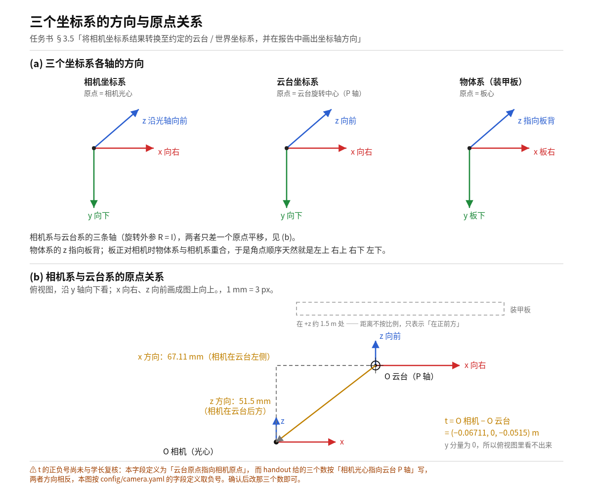
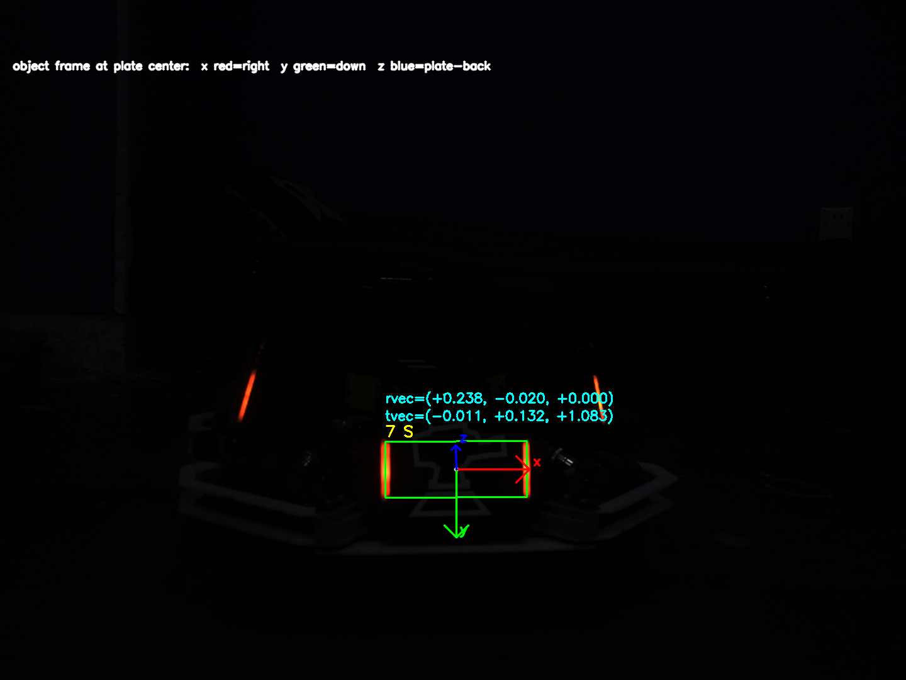

# 位姿解算（§3.5）答辩材料

对应评分项：**位姿解算（15 分）**
对应提交：`f6f0236` —— `实现 armor_solve 位姿解算和异常观测拒绝，Web Debug 补上 PnP 的 yaw/pitch`
代码位置：`student/src/StudentTasks.cpp:79-181`（`armor_solve`）

---

# 零、任务书四条要求逐条对照

任务书 §3.5 原文四条，逐字对：

| # | 任务书原文 | 落在哪 | 状态 |
|---|---|---|---|
| 1 | 根据 [装甲板尺寸](../装甲板尺寸.txt) 分别建立大小装甲板三维点 | `plateObjectPoints()` `StudentTasks.cpp:45-51`，小板 135×57 mm、大板 230×57 mm | 完成 |
| 2 | 使用学生标定的内参、畸变参数进行 PnP 解算 | `cv::solvePnP(..., SOLVEPNP_ITERATIVE)` `:122`，参数取自 `config/camera.yaml` | 完成 |
| 3 | 将相机坐标系结果转换至约定的云台/世界坐标系，**并在报告中画出坐标轴方向** | 变换 `:163-166`；**坐标轴方向图见本文件第一节** | 完成 |
| 4 | 计算距离、目标 yaw/pitch 和重投影误差；对 PnP 失败、深度非法或误差异常的观测进行拒绝 | 距离 = `tvec` 的模；yaw = `armor_yaw` `:168-176`；重投影误差 `:140-153`；四道闸见第四节 | 完成 |

> **第 3 条里的「约定」是本项目唯一需要口头确认的东西**，写在第一节末尾。

---

# 一、坐标轴方向图



（图源与重新导出方式：`docs/img/坐标系方向.svg` + `docs/img/render.sh`。
这台机器上没有 rsvg-convert / inkscape / ImageMagick，svg 光栅化只能走 Chrome 无头模式。）

## 1.1 三个坐标系各自怎么定义的

| 坐标系 | 原点 | x | y | z | 右手系 |
|---|---|---|---|---|---|
| **相机系** | 相机光心 | 右 | 下 | 沿光轴向前 | 是 |
| **云台系** | 云台旋转中心（P 轴） | 右 | 下 | 向前 | 是 |
| **物体系**（装甲板） | 板心 | 板右 | 板下 | 指向板背 | 是 |

三处都不是随便定的：

- **相机系的 y 向下**是 OpenCV 的约定，不用选。
- **物体系的 y 也取向下**（而不是向上）是**有意的**：跟相机系同向，
  省掉一次 180° 翻转，并且让「板正对相机」时 `armor_yaw = 0` 而不是 `±π`。
  （`StudentTasks.cpp:40-44` 的注释写了这个取舍。）
- **物体系 +z 指向板背**：板正对相机时物体系与相机系**完全重合**，
  于是 `plateObjectPoints` 给的四个点（左上 右上 右下 左下）天然和
  `ArmorDetection::corners` 的顺序约定一致，不需要额外换序。

## 1.2 相机系 → 云台系：R = I，只有平移

这是本项目的**约定**（学长口径：相机系与云台系只有平移没有旋转）：

```
p_云台 = R · p_相机 + t        R = I（单位阵）        t = (−0.06711, 0, −0.0515) m
```

`R = I` 是那个约定下的**真值**，不是占位符 —— 只要把云台系**定义成与相机系同向**，
两个系的三个轴就一一平行，旋转就确实是单位阵。任务书只说「约定的云台/世界坐标系」，
没有规定是哪一套，`云台外参.md` 也只要求「说明两个坐标系各轴方向」。
**把约定写清楚，这里就是自洽的。**

另一套同样自洽的约定是 `armor/include/BulletModel.hpp:6` 的枪管系（x 前 / y 左 / z 上），
那时 R 是一个 90° 置换矩阵。**两套都对，本项目选了前一套。**
代价是：`position_gimbal_m` 活在「x 右 / y 下 / z 前」里，
而 `BulletModel.hpp` 假设「前 x / 左 y / 上 z」、串口 yaw/pitch 符号未定 ——
**接串口那一步要补一个置换**，这是后话，不影响 §3.5。

## 1.3 图 (b) 那几个数怎么来的

俯视图按比例画（1 mm = 3 px），从图上一眼能读出来的两个数：

- **x 方向 67.11 mm** —— 从云台看，相机在**左侧**；
- **z 方向 51.5 mm** —— 从云台看，相机在**后方**。

y 分量为 0，所以俯视图里看不出来（相机和云台等高）。

**t 的正负号（2026-10-13）。** 本字段定义是「云台原点 → 相机原点」= `O_相机 − O_云台`。
学长 2026-10-13 答：外参是**「云台 P 轴到相机光心」**，与这个定义同向，
`config/camera.yaml` 据此把三个数填成 **`(+0.06711, 0, +0.0515)`**。
但 `云台外参.md` 正文把这组数写成「相机光心到云台 P 轴」的向量，方向与上面相反，
**按那句读应取负号**。两处只能有一个对，**尚未一句钉死**。

⚠ 因此**本节下面的 §1.2 那个 t 值、§1.3 的「相机在左侧／后方」、以及俯视图，
目前仍按负号画着，与 `config/camera.yaml` 暂不一致**。确认后三处要一起改，图和代码都要动。

## 1.4 同一套坐标轴也画在 UI 上（以装甲板中心为原点）

报告里那张是"约定的说明图"。**同一套约定在运行界面上也是看得见的**：
自测程序 `armor_live` 对每一块通过三道闸的装甲板，在**板心**画出物体系的三条轴 ——
**x 红 = 板右、y 绿 = 板下、z 蓝 = 指向板背**，配色和方向跟上面那张图完全一致。



这是真实帧回放（同一块板连拍三帧之一），不是示意图：

- 该帧 `rvec = (+0.238, −0.020, +0.000)`，主要是绕 x 轴转 13.6°，
  于是物体系 +z（板背法向）在相机系里是 `(0, −0.236, 0.972)` —— 朝前且略朝上。
- 投影出来 **z 蓝轴确实很短、指向上方**（几乎沿光轴，被透视压扁），
  **y 绿轴指向下方**，**x 红轴水平向右且不吃透视**。
- 三帧之间 `rvec` 最大差 0.030 rad ≈ 1.7°，坐标轴几乎不动 —— 不是抖出来的。

也就是说，轴不是画一个固定的三叉戟贴上去的，**位置和姿态都来自 PnP 解出来的
`rvec`/`tvec`**；板一斜，轴跟着斜。**"在报告中画出坐标轴方向"和"界面上看得见"
这两件事，用的是同一套约定。**

> 细节与三帧原始读数见 `rm_autoaim_evidence/05-位姿解算/20261011-UI以装甲板中心画出物体系坐标轴.md`。
> 注意 `armor_live` 是**开发期自测工具**，在仓库外、不进提交（自检脚本不交）。

---

# 二、大小装甲板三维点

`plateObjectPoints(size)` 按大小给两套点，都是板心为中心、z = 0 平面上的矩形四角：

| 大小 | 宽 | 高 | 四个点（物体系，m） |
|---|---|---|---|
| `Small` | 0.135 m | 0.057 m | (−0.0675, −0.0285, 0) (0.0675, −0.0285, 0) (0.0675, 0.0285, 0) (−0.0675, 0.0285, 0) |
| `Large` | 0.230 m | 0.057 m | 同构，x = ±0.115 |

顺序固定 **左上 → 右上 → 右下 → 左下**，与 `detection.corners` 一一对应。

**一个已经量过的坑**：大小判错时，PnP **不会报错**，而且**距离几乎不动**。
在真实帧 `hik_capture/barscene/hik_00.png` 上实测：
把小板（135）当成大板（230）解，重投影误差 0.82 → 0.97 px（照样过 5 px 的闸），
深度 1.491 → 1.629 m（**只差 9%**），**但 yaw 从 −0.042 rad 甩到 +0.811 rad（+46°）**。
也就是说，解算器把尺寸误差**吸收成了旋转**，不是缩放。
**四道闸一道都拦不住大小判错** —— 所以大小分类的正确性得由检测那一环保证，
不能指望位姿这一环兜底。（数值与推导见 `rm_autoaim_evidence/05-位姿解算/`。）

---

# 三、PnP 本身

```cpp
cv::solvePnP(object, image, camera_matrix, distortion, rvec, tvec,
             false, cv::SOLVEPNP_ITERATIVE);
```

- 输入：物体系 4 个三维点 + 图像上 4 个像素角点；内参/畸变来自 `config/camera.yaml`
  （本机标定值 fx 1806.7 / fy 1804.4 / cx 743.4 / cy 526.1，畸变 `[-0.0818, 0.1680, 0, 0, −0.0283]`，
  1440×1080，标定重投影 0.0753 px）。
  **2026-10-13 起 `config/camera.yaml` 已换成第二阶段上车相机的内参**
  （fx 1782.6 / fy 1784.3 / cx 749.4 / cy 574.7，畸变 `[-0.0357, -0.1533, 0, 0, 1.1905]`）；
  本节的推导与结论不受影响，换的只是数值来源。
- 输出：`rvec`（物体系 → 相机系的旋转）、`tvec`（**板心在相机系中的位置，单位 m**）。
- `tvec` 直接就是 `position_camera_m`，不需要再换算。

**必须知道的一件事**：`solvePnP` 对**几乎所有坏输入都返回成功**。
角点缩到 2% 时它给出 100 m 的距离，角点摆成蝶形时它给过 z = 5e11，
角点顺序反了它给出一个**镜像解** —— 这三种情况下 `solvePnP` 的返回值都是 `true`，
重投影误差都是 0。**所以返回值不能当校验用**（`StudentTasks.cpp:128-131` 的注释写了这句）。

---

# 四、四道闸（异常观测拒绝）

任务书 §3.5 最后一句要求对「PnP 失败、深度非法、误差异常」拒绝。
实现上是**四道**，因为「PnP 不失败但解是错的」这种情况必须单独挡：

| # | 闸 | 条件 | 挡的是什么 | 位置 |
|---|---|---|---|---|
| 0 | 未标定 | `!camera.valid()` → 整体返回空 | 拿占位参数硬算（距离看着正常、实际全错） | `:93-95` |
| 1 | 角点退化 | `quadSignedArea(corners) < 1.0` → 丢这一条 | 四点重合/共线（面积 ≈ 0）；**顺序反了（面积为负）** | `:112` |
| 2 | 深度非法 | `!isfinite(depth) \|\| depth < 0.05 \|\| depth > 30` | 缩爆/拉爆角点解出来的假位姿（5e11、100 m） | `:132` |
| 3 | 误差异常 | `!isfinite(error_px) \|\| error_px > 5.0` | 角点形状自相矛盾 | `:152` |

第 1 道闸**故意不取绝对值**：取绝对值就等于把「顺序反了」当成正常输入放行，
而顺序反了的输入 PnP 会给出一个**位置正确、法向翻转**的解，重投影误差**仍然是 0** ——
误差和深度都拦不住，只有符号能拦。

第 2 道的两端都有物理含义：5 cm 时板已经贴在镜头上，30 m 超过 RM 场地长度（28 m）。

第 3 道的阈值 5 px 依据实测（合成探针 5 px ≈ 某个角点错了 20 px 量级；
真实帧角点抖动 ≤ 1.41 px、重投影 0.70~0.79 px，余量 6.4 倍）。
**但它拦不住"跨板配对"和"大小判错"**：实测一个跨车假对的重投影误差是 2.28 px，
照样过闸。详见 `rm_autoaim_evidence/05-位姿解算/`。

---

# 五、算出来的四个量

| 量 | 怎么算的 | 位置 |
|---|---|---|
| **距离** | `tvec` 的模（板心到相机光心） | `:159` |
| **相机系位置** | `position_camera_m = tvec` | `:159` |
| **云台系位置** | `position_gimbal_m = R·tvec + t`（全函数唯一用到外参的地方） | `:163-166` |
| **`armor_yaw`** | 物体系 +z（板背法向）→ 相机系 → 云台系，取 `atan2(x, z)`；正对时为 0 | `:168-176` |
| **重投影误差** | `projectPoints` 回来和原角点比 | `:140-153` |

⚠ **`armor_yaw` 的定义存疑**：这里实现的是「板面**法向**在云台系中的方位角」。
但任务书三处措辞（§3.5「目标 yaw/pitch」、`target_yaw`、
`PredictionResult::target_yaw`「最终云台指令」）都指向**板心方位角**。
两者在板正对时相等，板斜了就不等。**待拍板，没定之前不翻。**

pitch 不在 `armor_solve` 里：它由下游从 `position_gimbal_m` 现算
（`main.cpp` 的 `pnp_pitch_rad`），因为 pitch 是「云台要抬多少」，
跟云台当前姿态有关，不属于单帧解算的输出。
