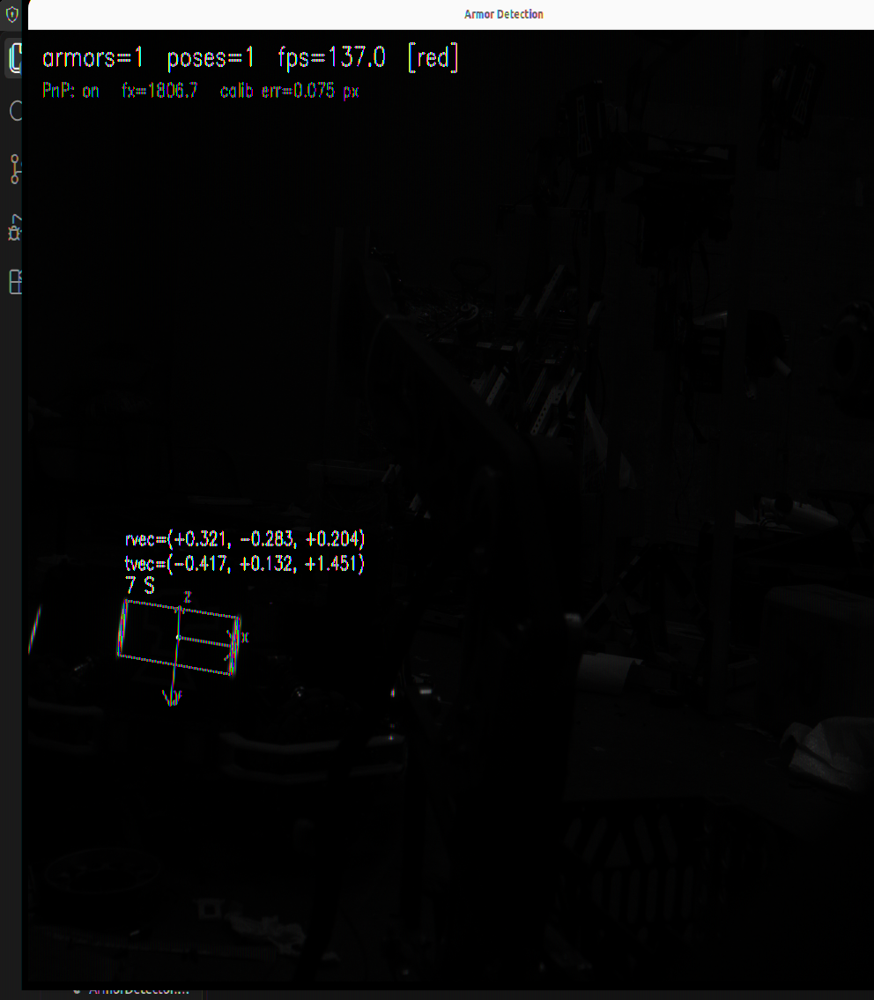
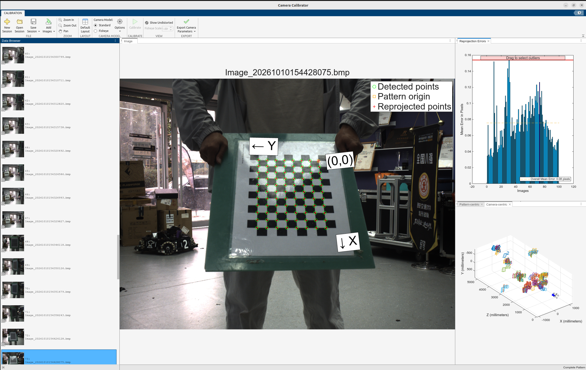
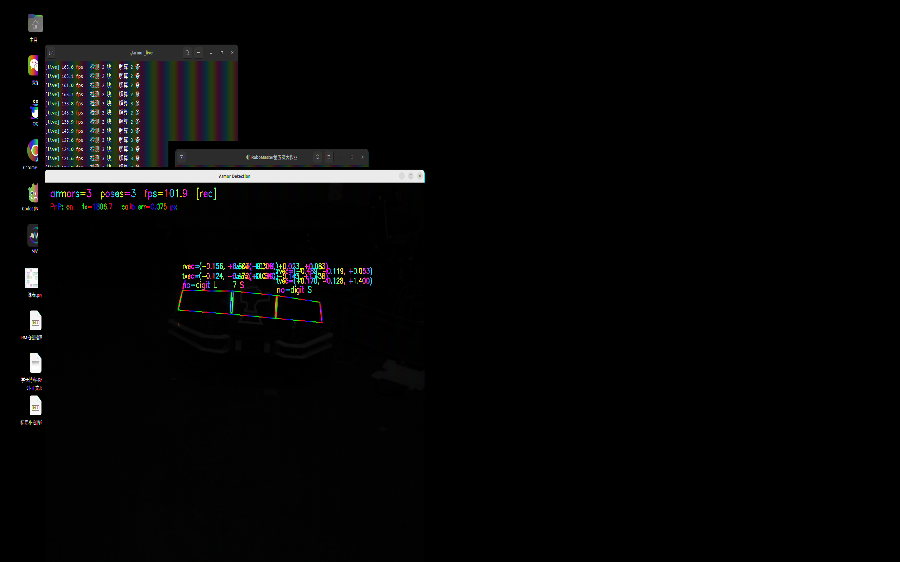
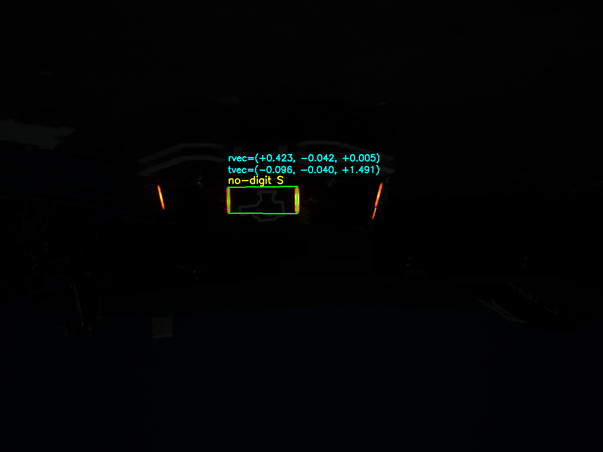
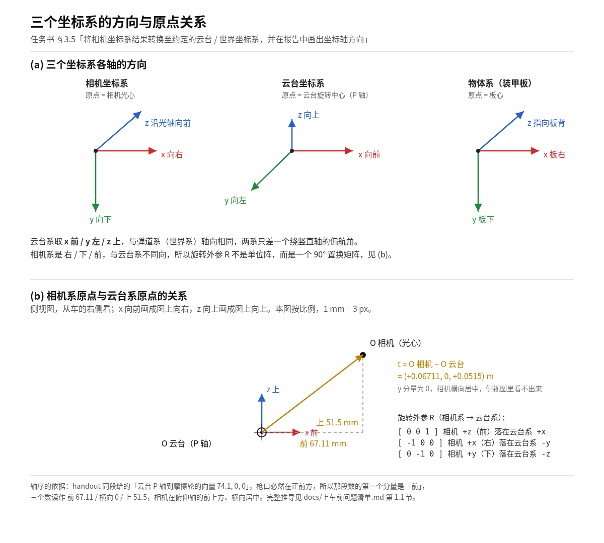
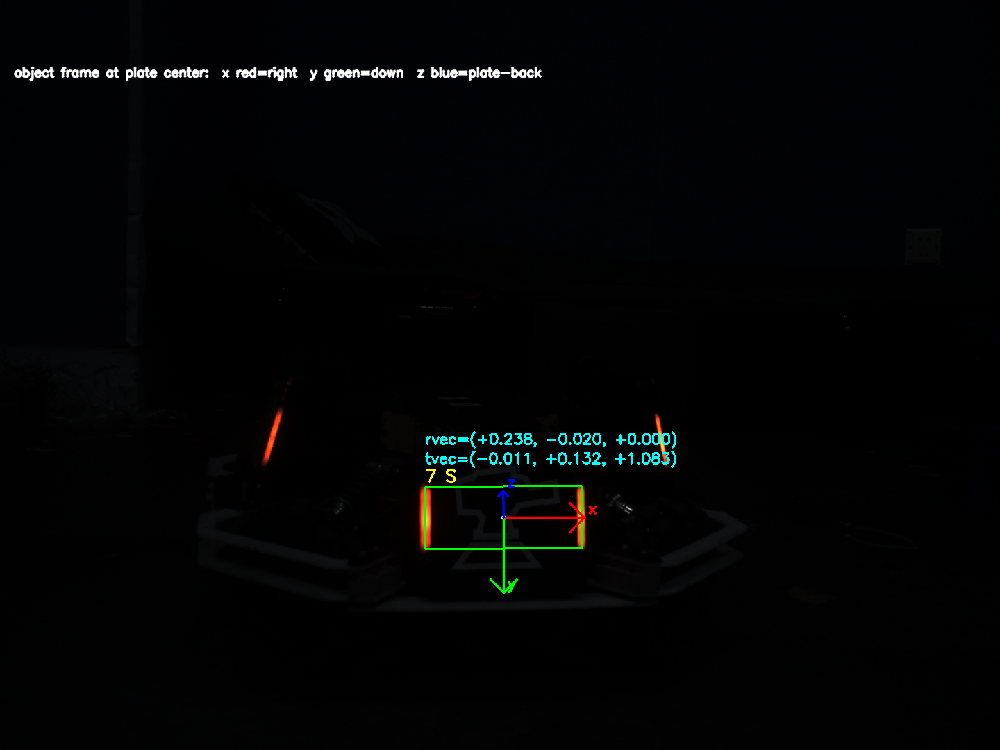
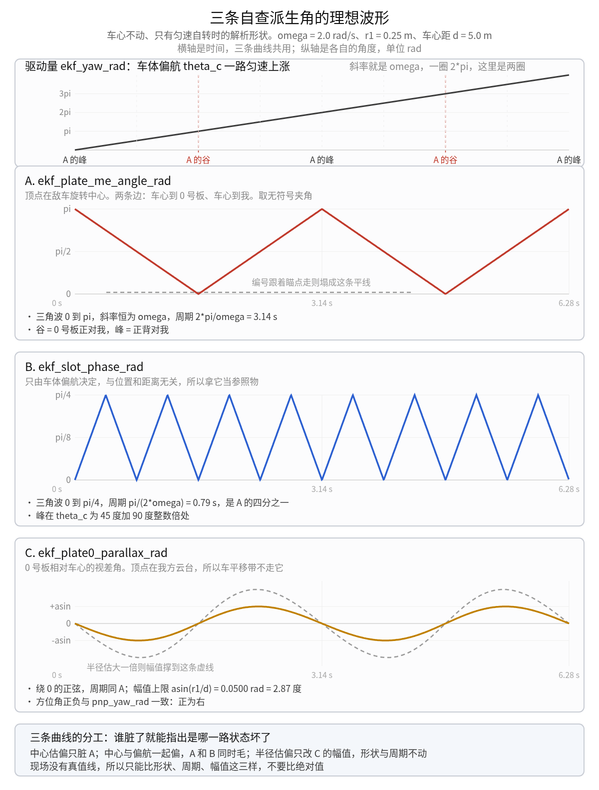
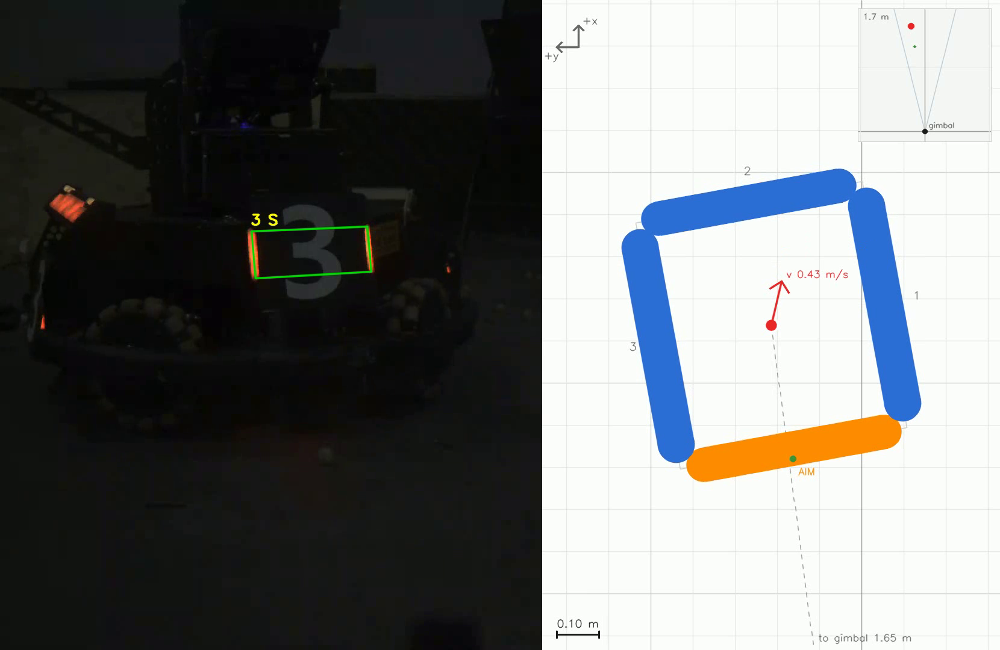
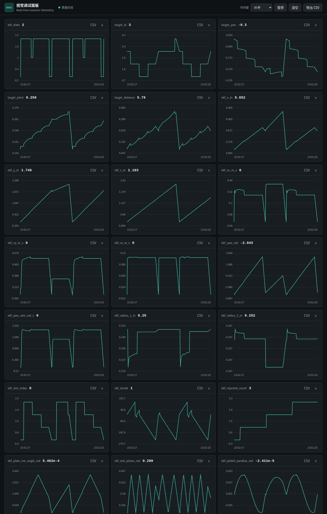

# 一页总览

这一页回答三个问题：七项任务各占多少分，一帧图像从进来到出去经过哪些函数，每一节的证据在哪个文件里。

## 分值分布

| 任务书条目 | 分值 | 现场要看的东西 | 本文章节 |
| --- | ---: | --- | --- |
| 环境配置与工程 | 10 | 干净目录能构建，四个接口对得上，设备与线程能收干净 | 3.1 |
| 串口与双线程 | 10 | 64 字节布局不变，收发不停，开火位不敢乱给 | 3.2 |
| 相机取流与标定 | 15 | 连续取流、断流不退出且自动重连、内外参怎么进解算 | 3.3 |
| 装甲板识别 | 25 | 灯条不误配、大小与数字判得对、丢目标有交代 | 3.4 |
| 位姿解算 | 15 | 两种板都解得准，坐标变换对，坏观测进不来 | 3.5 |
| EKF 跟踪与预测 | 20 | 转起来跟得住，换板不丢，遮挡后能回来 | 3.6 |
| Web Debug 与答辩 | 5 | 曲线能指出问题在哪一层，不是只看热闹 | 3.7 |

## 一帧的路径

```
HikCamera::grab                       取一帧 BGR，超时返回 false
  ArmorDetector::detect               掩膜 -> 灯条 -> 配对 -> 角点 -> 大小 -> 数字
    armor_solve                       solvePnP -> 四道闸 -> 相机系到云台系
      TargetSelector::select          多车聚簇、打分，只留一辆
        ArmorEkf::predict             按 dt 外推
        ArmorEkf::update              逐条观测关联与更新
        ArmorEkf::advanceStateMachine 0/1/2 三态
        ArmorEkf::buildPrediction     预测到「现在 + 延迟」，弹道与枪口偏移
          applyPrediction             填 64 字节帧
            SerialPort::Write         一次写满 64 字节
```

七个环节里只有 `armor_solve` 之后的位置量是米、在云台系里；检测输出的全是像素，EKF 输出的全是米。整条链上每个函数都是纯的，输入输出都在参数里，唯一的跨帧状态在两处：`ekf_predict` 里的 `static ArmorEkf filter` 与 `static TargetSelector selector`，以及 `main.cpp` 里受一把锁保护的控制器帧。

帧率上限由取流决定，实测 164.6 fps，画到屏幕上的那条路径要再打折：`imshow` 每帧重建一次窗口时只有 62.5 fps，改成 `namedWindow` 建一次之后是 149 fps。这条差别见 3.3。

## 任务、代码、场景

| 任务书 §3 | 主文件 | 必验场景 |
| --- | --- | --- |
| 3.1 环境与工程 | `main.cpp`、`student/src/StudentTasks.cpp` | 场景 1、8 |
| 3.2 串口接入 | `serialPort/include/Communication.hpp`、`src/AppSupport.cpp` | 场景 2 |
| 3.3 相机取流与标定 | `student/src/HikCamera.cpp`、`config/camera.yaml` | 场景 3 |
| 3.4 装甲板识别 | `student/src/ArmorDetector.cpp`、`student/src/DigitClassifier.cpp` | 场景 4 |
| 3.5 位姿解算 | `student/src/StudentTasks.cpp` 的 `armor_solve` | 场景 4 |
| 3.6 EKF 跟踪与预测 | `student/src/ArmorEkf.cpp`、`student/src/MeasYawRate.cpp` | 场景 5、6 |
| 3.7 Web Debug | `web_debug/`、`main.cpp` 的打点段 | 场景 7 |

# 3.1 环境与工程

## 这段代码做什么

工程只做一件事：让外部替换进来的四个函数，被主程序以一个固定节奏反复调用，同时保证任何一步失败都不会让机器打出一发不该打的弹。

`main.cpp` 是唯一的主程序。它开两个线程：读线程只碰串口，操作线程只碰相机与算法。`student/` 下的代码被编译成静态库，主程序按 `StudentTasks.hpp` 里的四个声明调用它，不知道里面是 SVM 还是别的。

## 怎么做

### 目录分层

| 位置 | 内容 | 在一帧里的位置 |
| --- | --- | --- |
| `main.cpp` | 初始化、两个线程、一帧流水线、退出 | 全程 |
| `student/include`、`student/src` | 四个任务函数，7 个头文件与 6 个实现 | `get_pic` 到 `ekf_predict` |
| `include/`、`src/` | 公共类型与标定加载，安全输出与预测落盘 | 流水线首尾 |
| `armor/` | 弹道模型 | `buildPrediction` 内部 |
| `serialPort/` | 64 字节帧结构、串口读写 | 流水线出口 |
| `web_debug/` | 日志环形缓冲、SSE、MJPEG | 旁路，不参与控制 |
| `tests/` | 12 项用例 | 旁路 |

### 四个接口

```cpp
bool get_pic(cv::Mat& pic);
std::vector<ArmorDetection> armor_detect(const cv::Mat& pic, TeamColor enemy_color);
std::vector<ArmorPose> armor_solve(const std::vector<ArmorDetection>& detections,
                                  const CameraParameters& camera,
                                  const GimbalState& gimbal);
PredictionResult ekf_predict(const std::vector<ArmorPose>& observations,
                             const GimbalState& gimbal, double timestamp_seconds);
```

四个函数的共同约定：失败返回空或返回 `state == NoTarget`，不抛异常，不在这里终止进程。主程序按返回值决定这一帧是否降级，而不是按某个全局标志决定。

### 一帧的调用链

`main.cpp:487` 起 Web 服务，`:497` 取一份最新控制器帧，`:503` 判断新鲜度与合法性，`:516` 调 `get_pic`，`:556` 调 `armor_detect`，`:572` 调 `armor_solve`，`:614` 调 `ekf_predict`，`:615` 调 `applyPrediction` 落进结构体，`:635` 写串口。九个位置就是任务书 §4 那张调用图的逐行实现。

`ekf_predict` 里的跨帧状态是两个 `static` 对象：`static ArmorEkf filter` 与 `static armor::TargetSelector selector`，位于 `student/src/StudentTasks.cpp:228-229`。操作线程是唯一调用者，所以不需要加锁。

### 12 项用例

| 用例 | 覆盖什么 |
| --- | --- |
| `scaffold_safety` | 未初始化时默认输出禁止开火 |
| `armor_detect_geometry` | 灯条与配对的纯几何判据，用合成形状造用例 |
| `armor_detect_pipeline` | 掩膜到数字分类的整条管线 |
| `armor_solve_pnp` | PnP、角点顺序、重投影闸，用已知位姿的三维点自造真值 |
| `digit_classifier` | 数字分类，从最稳定的特征排到最依赖数据的部分 |
| `ekf_predict` | 状态机与预测输出，离线烟测 |
| `meas_yaw_rate` | 由云台角与板方位推角速度 |
| `target_selector` | 一帧两辆车时的聚簇与选择 |
| `frame_overlay` | 网页画面标注，六条判据含「无检测时不动一个像素」 |
| `ekf_adapter` | `ekf_predict` 适配器与它的 static 状态 |
| `web_frame_stream` | MJPEG 通道的断链与重连 |
| `cli_help` | 命令行帮助 |

### 退出路径

收到 SIGINT 后 `shutdown_requested` 置位，两个线程各自在循环顶部看见它。`main.cpp:400` 先建读线程再建操作线程，`:415` 与 `:419` 反序 join，先收操作线程是为了让它不再往串口写；`:422` 停 Web 服务，`:423` 删串口对象。相机句柄在 `HikCamera` 的析构里按 `StopGrabbing`、`CloseDevice`、`DestroyHandle`、`MV_CC_Finalize` 的顺序释放。

## 哪里会错

- 只 join 一个线程就退出，另一个线程还握着 `serialPort`，析构时删两次。
- 把 `ekf_predict` 的 static 状态当成线程安全。现在只有一个操作线程，一旦加第二个调用者就会两个滤波器抢一套槽位。
- 在四个函数里直接 `return` 一个「看起来正常」的默认值。距离 0、编号 0、`state` 却是 `Stable`，是这条链上最危险的一种错，所以每个出口都配了对应的合法性检查。

# 3.2 串口接入

## 这段代码做什么

把 EKF 的一帧结果变成线上 64 个字节写出去，同时把 MCU 发来的云台角收进来给算法用。协议一个字节都不能动，改动只能发生在结构体之外的转换里。

## 怎么做

### 结构体就是协议

`serialPort/include/Communication.hpp:8-10` 定义帧头 `0x71`、帧尾 `0x4C`、帧长 64。结构体用 `#pragma pack(push, 1)` 单字节对齐，二十个字段拼满 64 字节，每个字段的偏移都由 `static_assert(offsetof(...))` 钉死，从 `head` 的 0 到 `tail` 的 63，`crc` 固定在 61。少写一个断言，编译器换个版本就可能悄悄插入填充字节。

字段按方向分两组：

| 方向 | 字段 | 偏移 |
| --- | --- | --- |
| MCU 到视觉 | `yaw`、`pitch`、`roll`、`status`、`bias` | 1、5、9、13、20 |
| 视觉到 MCU | `armor_flag`、`latency`、`distance`、`coo_x`、`coo_y`、`fire_allowance`、`target_yaw`、`target_pitch`、`yaw_vel`、`pitch_vel`、`crc` | 15、16、24、32、36、44、45、49、53、57、61 |

`crc` 这个名字来自历史协议，它不是校验和，承载的是 EKF 三态：`NoTarget 0`、`Stable 1`、`Unstable 2`，与 `TrackingState` 的枚举值一一对应。任务书把「把 `crc` 当校验和」列为安全约束的红线，原因就在这里：一旦按校验和实现，MCU 收到的状态位就变成了随机的字节。

### 两个线程怎么交接

读线程收满 64 字节，校验帧头帧尾，然后 `publishFrame`。操作线程在每帧开始 `copyLatestFrame` 取一份。两边的共享量有三个：最新帧 `temp`、它的到达时间、以及「有没有收到过」这个布尔量，三者由**同一把** `message_mutex` 保护。

一把锁而不是三把，理由是这三个量必须成套读。分开加锁，操作线程可能拿到刚更新的帧配上一次的时间戳，500 ms 过期判定就永远不成立，控制器掉线时机器还在按最后的姿态开火。

操作线程把帧拷进自己的 `translator` 之后只用局部副本，写回时不再加锁，因为这半边只有它一个写者。

### 过期与降级

`frameIsFresh` 比的是 `steady_clock` 的差值，阈值 500 ms。超时、或者 `hasFiniteControlInput` 发现 `yaw`、`pitch`、`roll`、`bias` 里有 NaN，就走 `setSafeOutput`：允许开火位置 0，`target_yaw` 退回当前云台角，`crc` 置 `NoTarget`。**降级也要照常写一帧出去**，MCU 那边靠帧的连续性判断视觉是否活着，静默等同于掉线。

### 开火位的四道闸

| 位置 | 条件 | 动作 |
| --- | --- | --- |
| `main.cpp:503` | `status` 不是 0 或 5 | 整帧 `setSafeOutput`，敌方颜色取不到就不出手 |
| `AppSupport.cpp:82` | `state == NoTarget` 或结果里有非有限值 | `setSafeOutput` |
| `AppSupport.cpp:101` | `state != Stable` | 允许开火位置 0 |
| `AppSupport.cpp:103` | `Stable` 且 `fire_allowed` | 允许开火位置 1 |

四条里前三条只会把开火位往 0 压，最后一条是唯一能置 1 的地方。这样即使 `buildPrediction` 里出现没预料到的组合，安全方向也是唯一的方向。

开火位与 `crc` 是紧挨着赋值的两个字段，同一个 `prediction.state` 分叉出两个条件：

```cpp
message.crc = static_cast<std::uint16_t>(prediction.state);
message.fire_allowance = prediction.state == TrackingState::Stable &&
                                 prediction.fire_allowed
                             ? 1U
                             : 0U;
```

`src/AppSupport.cpp:100-104`。`fire_allowance == 1` 必然 `crc == 1`；反过来不成立，`crc == 1` 时炮口没对上照样给 0。电控侧可以分两个用途：`crc` 拿去做状态显示，开火位拿去做打弹判决。

### 写出去

`writeFrame` 每次写之前重设帧头帧尾，然后要求一次 `Write` 返回完整的 64。返回短了就打印一行并置位退出标志，不重试、不补写。半帧流到 MCU 上会被当成一帧解析，后面的字节全部错位，宁可停机。

## 哪里会错

- 结构体里加一个字段。`static_assert` 会在编译期挡住，这是刻意留的。
- 用 `sizeof` 而不是常量 64 去读串口缓冲区。`Translator` 是 union，`data` 只有 64 字节，用错长度会越界。
- 在读线程里做解析以外的事，比如顺手算个滤波。读线程一慢，MCU 的发送缓冲区满了就会丢帧，而操作线程完全看不出异常。

# 3.3 相机取流与标定

## 这段代码做什么

拿一张可以立刻做 PnP 的图：非空、`CV_8UC3`、BGR、方向正确。再把标定文件里的内参、畸变、外参喂给解算，让「像素」变成「云台系里的米」。

## 怎么做

### 打开与取流

`HikCamera::openOnce` 的顺序不能换：

1. `MV_CC_Initialize`
2. `EnumDevices(MV_USB_DEVICE | MV_GIGE_DEVICE)`
3. `CreateHandle`、`OpenDevice`
4. 关自动曝光、写曝光时间、关自动增益、写 6 dB、关自动白平衡
5. `TriggerMode = 0`
6. `StartGrabbing`

第 4 步的顺序有硬理由：`ExposureAuto` 还开着的时候写 `ExposureTime`，值会被自动曝光立刻覆盖，读数看上去正常但每帧都在变，PnP 的距离就会跟着抖。源码在 `HikCamera.cpp:132-138` 把这个顺序和理由写在一起。

海康的 U3V 相机是 USB3 Vision 设备，不出现 `/dev/video*`，所以程序参数是标定文件而不是设备节点，取流走 MVS SDK 而不是 V4L2。

`grab` 取一帧，单帧等待上限 1000 ms，超时返回 `false`。失败分两层处理，合起来就是断线重连：

- 设备层。连败 5 次 `close()` 放掉句柄。此后每次 `grab()` 走重开，但按 `kReopenIntervalMs = 1000` 节流（`HikCamera.cpp:173-195`），因为一次枚举实测约 100 ms，上层又是按帧调，不节流就是每帧多等这么久、终端每秒刷二十行。插回 USB 后 MVS 重新枚举得到设备，`openOnce()` 把参数、自由运行、`StartGrabbing` 重做一遍，并重新注册退出钩子。
- 主程序层。`main.cpp:517-533` 取不到图就不往下走：写一帧安全输出（`crc` 置 `NoTarget`、`fire_allowance` 置 0），让出 10 ms，`continue`。进程不退出，`empty_frame` 持续涨，网页 `camera_fps` 掉到 0。

拔掉 USB 之后逐帧发生的事：

| 时刻 | `failStreak_` | 发生什么 |
|---|---|---|
| 掉线后第 1 到 4 帧 | 1 到 4 | `grab()` 返回 false，上层写安全帧，`empty_frame` 涨 |
| 第 5 帧 | 到 5 | `close()`：停流、关设备、销毁句柄，`handle_` 置空，计数归零 |
| 第 6 帧 | 0 | 试开一次；失败，打「相机不可用，每 1000 ms 重试一次」，冷却窗口推到 1 秒后 |
| 之后 1 秒内 | 0 | 只比一次时钟就返回，不碰 SDK |
| 每满 1 秒 | 0 | 再试一次；失败继续推窗口，不再重复打日志 |
| 插回后的某次尝试 | 0 | `openOnce()` 成功，打「相机已恢复，继续取流」，回到在线 |
| 下一帧 | 0 | 拿到非空图，`empty_frame` 回零，帧率与画面恢复 |

SDK 若每帧都等满超时，走到第 5 帧的上限是 5 秒；每帧报错很快则远小于这个数。

恢复时 `grab()` 打一行 `[camera] 相机已恢复，继续取流`，之后 `empty_frame` 回零、帧率回到正常档位。无相机的情况下 `tools/grab_one` 实测每 1 秒重试一次、20 次共 21 秒，不崩不卡；插回后自动接上这一条要上车验，拔掉 USB 等几秒再插回，看这一行日志与网页 `empty_frame`。

不补黑图是改过的决定。黑图喂给检测和 EKF 都是白跑一遍，输出本来就得在 `main.cpp` 里强制置安全，不如直接跳过下游。安全帧仍然写，因为视觉静默等同于掉线，电控靠帧的连续性判断这一路还活着。

### 帧率

取流的上限先被 USB 链路卡过一次。同一台相机、同一份代码，换线之前 24 fps，换线之后 164.6 fps，原因是旧线协商回了 USB2 的带宽。这条排查记在工程文档里，因为它的表现和「算法慢」一模一样。

排除取流之后，剩下的上限由显示路径决定。`imshow` 每帧内部重建一次窗口时 62.5 fps，改成 `namedWindow` 建一次之后 149 fps；相机与检测本身能跑 164.6 fps。



### 内参怎么进解算

`config/camera.yaml` 里的 `camera_matrix` 与 `distortion_coefficients` 直接传给 `cv::solvePnP`，中间不做任何缩放。当前配置：`fx 2433.8`、`fy 2437.4`、`cx 679.3`、`cy 571.8`，畸变五项 `[-0.0129, -0.3517, 0, 0, -0.1536]`，水平视场角 33 度。

标定质量要说清是哪一轮。2026-10-10 那轮本机标定拍了 99 张棋盘格，MATLAB 的 `cameraCalibrator` 给出总体重投影误差 0.08 px。当前这组内参是 2026-10-24 从车上那台机器的 `CameraConfig.yaml` 取来的，那轮的重投影误差没有取到，`config/camera.yaml:146` 写着这一点；屏幕上 HUD 的 `calib err=0.075` 读的也是这个旧值，不是当轮的测量。对当前 K 能核的是四角径向因子 0.989~0.993。



内参比例对不对有一个便宜的判据：把画面四角按 K 反投影成方向向量，再投影回去，四角的缩放因子应当在 1 附近。这一组是 0.989 到 0.993，偏 1% 以内，说明 K 与实际视场匹配。换成另一支镜头那次，这个因子直接掉到明显偏离 1 的值，比看距离更快发现问题。

### 外参：哪个系量的

外参是一条刚体变换，`include/AutoAimTypes.hpp:36-37` 把公式写在类型定义旁边：

```
p_gimbal = R_camera_to_gimbal * p_camera + t_camera_to_gimbal
```

`R` 是 `[[0,0,1],[-1,0,0],[0,-1,0]]`，作用只是把两套轴的命名对齐：相机系是右、下、前，云台系是前、左、上，差一个 90 度置换。`t` 是相机光心在云台系里的位置，单位米，当前 `(0.0708, 0, 0.0843)`。

`mount_pitch_deg` 是另一回事，它与 `R` 不重复。`R` 只表达两套轴的命名差别，而相机支架实际装得光轴向下偏了 7.5 度，这是物理安装角度。解算时先把它补偿掉再乘外参：

```cpp
const cv::Mat R_measured_to_nominal =
    pitchRotationRadians(-camera.mount_pitch_deg * CV_PI / 180.0);
const cv::Mat R_effective = R_camera_to_gimbal * R_measured_to_nominal;
```

角度取负号，因为 `pitchRotationRadians` 的正角是抬，这里要抵消的是向下偏。只转方向不挪平移：相机绕光心转，光心在云台系里的位置不变。不补这一项的后果是整块板被读高 `d · tan(7.5°)`，2 m 处约 26 cm，而且不报错。

### 标定无效时

`armor_solve` 第一行就 `if (!camera.valid()) return poses;`。`valid()` 检查矩阵尺寸、是否有限、以及是否仍是占位值。返回空而不是拿默认值硬算，因为用占位内参解出来的距离「看着正常」，是最难查的一类错。

## 哪里会错

- 相机倒装时只改 `grab` 里的旋转，不改主点。`ROTATE_180` 之后主点要换成 `w-1-cx`、`h-1-cy`，两处必须成对，单改一处偏 60 到 70 px，PnP 不报错，车心钉偏约 7 cm。
- 换镜头只改 `fx`。`fx`、`fy`、`cx`、`cy`、畸变、外参平移、`mount_pitch_deg` 是一整套，漏一项的表现各不相同，且都不报错。
- 把屏幕上那个 `calib err` 当成当前内参的精度。它打印的是 `config/camera.yaml` 里的 `mean_reprojection_error_px`，数值属于 2026-10-10 那轮本机标定，当前这组内参来自 10-24 车上那台机器，两者不是同一轮。这个数不随帧变化，看到它稳定不代表解算正确。

# 3.4 装甲板识别

## 这段代码做什么

输入一张 BGR 图与敌方颜色，输出若干块装甲板：每块带四个顺时针角点、大小类别、数字编号与置信度。所有判据都在图像层，一个像素也不进滤波。

输出结构是 `ArmorDetection`：角点顺序固定为左上、右上、右下、左下，`size` 是小或大，`target_id` 是 1 到 8，0 保留给「没有数字」与「没认出来」。

## 怎么做

### 七步管线

`detectArmors` 在 `ArmorDetector.cpp:718`，一条直线走下来，每步失败就返回空：

| 步 | 函数 | 输入到输出 | 入口的拒绝条件 |
| --- | --- | --- | --- |
| 1 | 类型归一化 | 任意图到 `CV_8UC3` | 空图、灰度、其它位深 |
| 2 | `buildColorMask` | BGR 到二值掩膜 | 不是三通道 |
| 3 | `extractLightBars` | 掩膜到灯条列表 | 少于 2 根 |
| 4 | `pairLightBars` | 灯条到候选对 | 没有候选 |
| 5 | `choosePairs` | 候选对到选中对，一对一 | 全被占用 |
| 6 | `classifySize` 与 `extractDigitPatch` | 选中对到大小与补丁 | 补丁失败不丢框 |
| 7 | `suppressOverlaps` | 去重 | IoU 超 0.3 |

第 5 步和第 6 步是同一个循环：先给每个候选对算草稿与证据，再统一挑。理由写在 `:755-758`：挑选要看板面对比度与数字，这两样必须读图，所以每个候选都躲不掉一次裁剪与分类。

### 颜色掩膜：一条有符号的差

只保留主通道与对立通道的**有符号差**，再与主通道自身的亮度相与：

```cpp
cv::subtract(main, other, diff);          // 蓝队 = B - R，红队 = R - B
cv::threshold(diff, strong, 60, 255, cv::THRESH_BINARY);
cv::threshold(main, bright, 100, 255, cv::THRESH_BINARY);
cv::bitwise_and(strong, bright, mask);
```

`cv::subtract` 对 8 位是饱和减法，负数截成 0，正好等于 `max(主 - 对立, 0)`。换成 `cv::absdiff` 就变成 `|B - R|`，红蓝两队的结果完全一样，对面车全变目标，而且不报错。这是整个函数唯一的坑，注释写在 `:551-555`。

两条阈值的分工：只判差值，暗灰蓝 `80/60/10` 这种也会进；只判亮度，偏色的高光会漏进来。两个都过才算，实测在靶场帧上 `|B-R| < 20` 的像素占 99.78%，`|B-R| >= 120` 的只占 0.13%，每帧留下的连通域 0 到 8 个，均值 2.6 个。

### 灯条：只看边长，不看角度

`extractLightBars` 用 `RETR_EXTERNAL` 只取最外层轮廓。用 `RETR_TREE` 时，过曝的灯条会烧穿中间那一层，同一根灯条被拆成里外两三个轮廓，每个都被当成独立灯条去配对，结果是「检测看起来很灵」的一堆假目标。

每个轮廓取 `minAreaRect`，然后**用四条边的长度**分出长短边，不读 `rect.angle`：OpenCV 3.x 的 `angle` 区间是 `[-90, 0)`，4.5 起改成 `[0, 90)`，靠它判断哪条边是长边会随版本变。

三个门槛：面积不小于 30 平方像素，长边不小于 20 像素，长短比落在 1.5 到 20 之间。长边门槛比的是灯条自己的长度，不是画面里的竖直跨度，斜着的灯条竖直跨度可以远小于长度；这个参数原来叫 `min_height`，名字误导过一次讨论。

两端取两条短边的中点，再强制 `top.y <= bottom.y`。`tiltDegrees()` 的正负号全押在这个约定上。

### 配对：六条判据

`pairLightBars` 是 O(n²) 暴力枚举，灯条通常个位数到十几根，n 小于 30 时开销可以忽略，换来的是每条判据都能单独测、单独注释。

| 判据 | 条件 | 挡住什么 |
| --- | --- | --- |
| 1 | 两根长度比不超过 1.8 | 一根灯条配上一段反光 |
| 2 | 中心高度差与平均长度之比不超过 0.6 | 上下错开的两个目标 |
| 3a | 各自绝对倾角不超过 45 度 | 横着的亮带、灯条反光 |
| 3b | 两根倾角差不超过 15 度 | 一横一竖凑成一对 |
| 4 | 间距比落在 1.2 到 6.0 | 太近是同一条的碎块，太远是跨板 |
| 5 | 中间不夹第三根灯条 | 跨两块板的那一对 |
| 6 | 左灯条排在 `first` | 保证角点顺序，不是过滤 |

判据 3 拆成两半，因为只看差值时两根都水平的亮片倾角差为 0，会满分通过。绝对倾角上限取 45 度，实测真实装甲板的最大倾角是 14.04 度，余量三倍多。

判据 4 是六条里最稳的：量纲相消，与分辨率、与远近都无关。但它挡不住跨板那一对。实测有一帧，跨板对的间距比是 5.05，正好落在合法区间内，五条全过，外接矩形还最大，NMS 按面积取大正好留它，最后裁出来的「数字补丁」其实是中间那根灯条。判据 5 就是为这一帧加的：纵向只在两根共同覆盖的高度带内判，避免把背景里纵向错开的远处目标误判成夹在中间。

### 一对一：三框 Bug 的根因

四根灯条会配出三个相邻候选，共用中间两根。不处理的话同一块板被报三次，画面上就是三个框套在一块板上。

`choosePairs` 按分数从高到低贪心：取一对，把两端灯条标记为已用，后面所有碰到已用灯条的候选全部跳过。排序用 `stable_sort`，分数打平时保持候选原顺序，结果才是确定的。

```cpp
std::vector<bool> used(bar_count, false);
std::vector<LightBarPair> chosen;
for (std::size_t k : order) {
    const LightBarPair& pair = candidates[k];
    if (used[pair.left_index] || used[pair.right_index]) {
        continue;  // 两端有一端已经被更好的那对占了
    }
    used[pair.left_index] = true;
    used[pair.right_index] = true;
    chosen.push_back(pair);
}
```

`student/src/ArmorDetector.cpp:296-307`。整个修复就是这一张占用表加十行循环，NMS 一行没动。

分数由三项组成：几何自洽度取负、板面对比度封顶 1、有数字再奖励 2。数字奖励有一个前置条件，这一对必须**先有板面**：数字印在牌面上，中间根本没有板面的候选读出来的 1 到 8 只能是背景误报，给它加分等于奖励噪声。板面对比度这一项实测在真板上是 2.03，在两块假板上是 0.30 与 0.18，差距足够大。

`choosePairs` 有一条刻意的约定：**不把结果过滤到空**。宁可留下一对可疑的，也不要让画面变成零目标，因为「检测坏了」与「这一帧真的没有车」在日志上必须能分开。



这一帧同时给出三种状态：中间那块读到 7，左右两块 `target_id` 是 0 但框与角点都对，PnP 照样解出 1.400 m。这正是「分类失败不丢板」的效果。

### 大小分类

判据只有一个比值：两根灯条中心的间距除以平均灯条长度。

```cpp
return (gap / mean_length >= split_ratio) ? ArmorSize::Large : ArmorSize::Small;
```

`split_ratio` 取 3.0，来源是两类各自的实测均值：小板 2.37，大板 4.04，取几何平均得 3.09，写成 3.0。用比值而不是绝对像素，是因为它同样与距离、分辨率无关。

退化保护单独写在前面：任一根长度为零就判小板。只在「平均长度为零」时拦不住一根 0 一根 60 的情况，平均是 30，间距比会被算成 4.4，反而判成大板。

### 数字分类

这一环把四个角点变成编号 1 到 8，或者 0 表示没有编号。分三段：先裁出一张 28 x 20 的补丁，再算 324 维特征，最后用 9 类线性 SVM 判类。

#### 一、补丁：三级尺度

补丁的裁剪分两级，几何都在 `extractDigitPatch`：

1. **撑开再正射**。检测出的四边形只框住两根灯条，而牌面上的图案比灯条高一截，直接照着裁会切掉上下缘。先把四边形绕中心放大 2 倍，再 `getPerspectiveTransform` 正射到「保物理比例」的规范板上。规范板尺寸等于物理毫米数乘像素密度：宽 135 或 230 mm，高 57 mm，2 像素每毫米，所以小板 270 x 114，大板 460 x 114。这一步同时把透视畸变去掉了，斜着看板子也能得到端正的数字。
2. **从规范板中央裁数字框**。框高取整块板高，不是按字形裁：数据集里量过，墨迹高度只占补丁高的 0.68 到 0.95 倍，说明训练数据本身就留了余量，按字形裁会得到比训练分布更紧的图。框宽不是独立参数，纵横比定成 20:28，框宽就唯一确定。

然后先缩放再 Otsu 二值化，顺序不能反。反过来 `INTER_AREA` 会把 0 和 255 平均成中间灰度，输出不再是训练数据那种二值图，不报错，只是准确率悄悄掉。

同一张图在三级上的分辨率差得很远。以 1.14 m 处一块板为例：

| 级 | 尺寸 | 一格代表 |
| --- | --- | --- |
| 原图上的数字区 | 约 87 x 122 像素 | 真实板面 0.47 mm |
| 规范板里的数字框 | 81 x 114 像素 | 真实板面 0.5 mm |
| 补丁 | 20 x 28 像素 | 真实板面约 2 mm |

「2 像素每毫米」说的是撑大之后的尺度：四边形放大 2 倍，规范板仍是 135 x 2 = 270 像素宽，所以在那张图上 1 像素 = 1 mm，折回真实板面是 0.5 mm。框高 114 像素正好等于板高 57 mm，这就是「框高取整块板高」的来源。

最后一步 `resize` 把物理尺度彻底丢掉：57 mm 压进 28 行，一行约 2.04 mm；40.5 mm 压进 20 列，一列约 2.03 mm。20 和 28 不是量出来的，是数据集补丁的尺寸，`DigitClassifier.hpp:27` 写死了这条契约。代码只要求一件事：现场抠出来的图和训练数据同分布。

这块补丁的尺寸踩过一次坑：早先窗按灯条框裁，只有 64 x 89 像素，而牌面图案实际有 150 像素高，图案上下被切掉，分类器看到的是残缺的数字，`no-digit` 频发。改成先撑开再正射之后才拿到完整图案，修复提交 `b0200f7`。

撑大倍数 2.0 不是拍的，是标定出来的：

```cpp
// 实测三帧：1.0（=旧行为）给出 0/0/4 三个不同答案，1.6 起三帧一致
// 收敛到同一类，峰值在 2.0~2.2。
//
// 这不是真值，是标定值：换镜头 / 换机型 / 换板子都要重标。
float patch_quad_scale{2.0F};
```

`student/include/ArmorDetector.hpp:157-160`。判据是同一块板的三帧读数一致性，不是某个理论的几何比例。



图中的绿框按撑开 2 倍后的四边形画，覆盖的是牌面而不是灯条，这正是补丁能读到完整图案的原因。

#### 二、特征：HOG

补丁先过一遍 HOG，方向梯度直方图。参数只定义一处，训练和推理共用同一份源码（`DigitClassifier.cpp:36-41`）：

```cpp
cv::HOGDescriptor& hog() {
    static cv::HOGDescriptor instance(
        cv::Size(DigitClassifier::kPatchWidth,
                 DigitClassifier::kPatchHeight),  // winSize   20 x 28，整幅补丁
        cv::Size(10, 14),   // blockSize   2 x 2 个 cell
        cv::Size(5, 7),     // blockStride 步进 1 个 cell
        cv::Size(5, 7),     // cellSize    一个 cell 覆盖 5 列 7 行
        9);                 // nbins       每个 cell 9 个方向
    return instance;
}
```

维度是这四个数算出来的：

```
cell  : 20 / 5 = 4 列，28 / 7 = 4 行          共 16 个 cell
block : 2 x 2 个 cell，步进 1 个 cell          共 3 x 3 = 9 个 block
bin   : 每个 cell 9 个方向，0 到 180 度每 20 度一档
特征  : 9 个 block x 4 个 cell x 9 个 bin = 324 维
```

324 这个数手算与 `getDescriptorSize()` 实测一致，测试里把它钉死（`tests/test_digit_classifier.cpp:74`）。

一个 cell 是 5 x 7 像素，对应真实板面约 10 x 14 mm。`compute` 在每个像素上求梯度，得到幅值与方向，按幅值加权投到相邻两个方向 bin 里，一个 cell 汇成 9 维；再把一个 block 里 4 个 cell 的 36 维拼起来做一次 L2 归一化，压掉整体对比度。324 个数最后量级都在 1 附近，与距离和曝光无关。

举例：数字 7 的那一竖穿过补丁左半边，竖笔两侧是水平方向的灰度阶跃，梯度方向落在 0 度或 180 度，落在这两个 cell 的 bin 0 与 bin 8；横笔穿过的 cell 则落在 90 度附近的 bin 4。判类靠的就是这张「哪个格子朝哪个方向」的表。

为什么用 HOG 而不是把 560 个像素直接塞进分类器：

- **对亮度不敏感**。现场曝光、反光、阴影改的是绝对灰度，不改笔画两侧的梯度方向。
- **对微位移不敏感到可接受**。一个 cell 覆盖 5 x 7 像素，角点抖一两个像素摊进直方图里几乎没有影响。
- **二值图正好合适**。0 与 255 的边缘最干净，方向分布非常尖锐，不像灰度图那样被中间色摊平。
- **维数比像素少**。324 小于 560，样本 17787 张，参数不至于过拟合。

`describe` 是特征这一级的唯一入口（`DigitClassifier.cpp:180-190`）：

```cpp
std::vector<float> DigitClassifier::describe(const cv::Mat& patch) {
    std::vector<float> descriptor;
    // 尺寸判断写 cols/rows。20 和 28 反了会算出另一套特征，且不报错。
    if (patch.empty() || patch.type() != CV_8UC1 ||
        patch.cols != kPatchWidth || patch.rows != kPatchHeight) {
        return descriptor;
    }
    hog().compute(patch, descriptor);
    return descriptor;
}
```

`hog()` 用的是函数内的静态变量：`HOGDescriptor` 构造要算一堆内部表，每帧重造是浪费，C++11 起函数内静态变量初始化是线程安全的。

#### 三、判别：9 类线性 SVM

类别表只有一份，训练与推理共用，顺序就是数据集目录的字典序（`DigitClassifier.cpp:22-26`）：

```cpp
constexpr const char* kClassNames[] = {
    "1", "2", "3", "4", "5", "6outpost", "7guard", "8base", "9neg"};
constexpr int kTargetIds[] = {1, 2, 3, 4, 5, 6, 7, 8, 0};
```

数组下标就是喂给 SVM 的标签。`9neg` 表示「这块 ROI 里没有数字」，映射到 0，对上「0 保留给未知目标」的约定。表写两份的话，准确率会照常显示，但每个数字都指向错的装甲板。

OpenCV 的多类 SVM 是**一对一**结构：9 个类两两配一个二分类器，共 9 x 8 / 2 = 36 个。线性核下每个二分类器就是一个超平面：

```
dfval(x) = w · x - rho
dfval > 0 表示这一对里 first 类胜，< 0 表示 second 类胜
```

`w` 是 324 维，`rho` 是一个标量。36 对合起来是一张 36 x 324 的权重表加 36 个偏置，模型文件 `models/armor_digit_svm.xml` 里存的就是这两样。判类时每一对投一票，票多的类胜出。

选线性核有两条理由：

- 特征已经是 324 维的方向直方图，数字之间的差别是笔画朝向的组合，线性切得开。留出集 180 张全对，说明这个判断成立。
- 只有线性核下 OpenCV 才把每个二分类器压缩成「一个权重向量加一个偏置」。换成 RBF 这类核，拿不到每对的 `w`，置信度只能退化成常数。

加载时按这两条核对，不合格在加载阶段就拒绝（`DigitClassifier.cpp:110-123`）：

```cpp
const int pair_count = class_count * (class_count - 1) / 2;   // 36
const cv::Mat weights = svm->getSupportVectors();             // 36 x 324

if (svm->getKernelType() != cv::ml::SVM::LINEAR ||
    weights.rows != pair_count ||
    weights.cols != DigitClassifier::kFeatureSize) {
    std::cerr << "[digit] 模型不可用：需要线性核，且能取到 one-vs-one 原始权重。"
              << std::endl;
    return false;
}
```

通过之后再枚举 36 对，把每一对的权重行号和偏置记下来（`DigitClassifier.cpp:125-150`）：

```cpp
int p = 0;
for (int i = 0; i < class_count; ++i) {
    for (int j = i + 1; j < class_count; ++j, ++p) {
        cv::Mat alpha;
        cv::Mat svidx;
        const float rho = svm->getDecisionFunction(p, alpha, svidx);
        // 压缩形式：每对只有一个「支持向量」，就是那个原始权重。
        if (alpha.total() != 1 || svidx.total() != 1) {
            return false;
        }
        Pair pair;
        pair.first = i;
        pair.second = j;
        pair.weight_row = svidx.at<int>(0);
        pair.rho = rho;
        pairs.push_back(pair);
    }
}
```

枚举顺序必须与 OpenCV 内部一致：(0,1) (0,2) 一直到 (0,8)，再从 (1,2) 起头。

判类本身只有三行（`DigitClassifier.cpp:271-276`）：

```cpp
cv::Mat label_out;
state.svm->predict(sample, label_out);
const int label = static_cast<int>(label_out.at<float>(0) + 0.5F);
result.target_id = targetIdForLabel(label);
```

`+ 0.5F` 是四舍五入。标签存成 float 再直接截断，会掉到 6.9999 变成 6。

模型不是编译期必须的。`ready()` 走懒加载，按五条候选路径找，第一条能加载的就用（`DigitClassifier.cpp:192-234`）。找不到就打一行提示，此后所有 `classify` 返回 `{0, 0}`，程序照常跑。候选表里既有编进二进制的绝对路径，也有相对路径，因为二进制拷到车上之后仓库目录名可能不同。

#### 四、置信度：自己算，不能用 RAW_OUTPUT

`predict` 带 `RAW_OUTPUT` 标志时，在多类情况下返回的**不是决策函数值，而是类别标签本身**：

| 实际类别 | RAW_OUTPUT 返回值 |
| --- | --- |
| 类 1 | 0.0 |
| 类 2 | 1.0 |
| 类 3 | 2.0 |
| ... | ... |
| 类 9neg | 8.0 |

拿它当 margin，置信度就成了「预测出哪个数字」的纯函数，数字越大越「可信」，与输入图像毫无关系。而且它看起来一切正常，这是最难发现的一类错。

正确做法是拿加载时记下的 36 组 `w` 与 `rho` 自己算。冠军类一共参加 8 场对局，每场算一个带符号的间隔，取最小值（`DigitClassifier.cpp:286-317`）：

```cpp
bool have_margin = false;
float worst = 0.0F;
for (const Pair& pair : state.pairs) {
    int sign = 0;
    if (pair.first == label) {
        sign = 1;        // 冠军是 first，赢了 dfval 为正
    } else if (pair.second == label) {
        sign = -1;       // 冠军是 second，赢了 dfval 为负，翻转后为正
    } else {
        continue;        // 与冠军无关的对局不影响结论
    }
    const float dfval =
        static_cast<float>(state.weights.row(pair.weight_row).dot(sample)) -
        pair.rho;
    const float signed_margin = dfval * static_cast<float>(sign);
    if (!have_margin || signed_margin < worst) {
        worst = signed_margin;
        have_margin = true;
    }
}
result.confidence = 1.0F / (1.0F + std::exp(-worst));
```

取最小值而不是平均值：只要有一个对手没被明显压住，就不该报高置信度。这正是「这个数字与某个易混数字只差一点」的样子。

符号方向核对过：1440 个「样本 x 它自己参与的每一对」，`w · x - rho` 的符号与真实胜负一致率 100%，写成 `+ rho` 只有 81%。

sigmoid 以 0 为界落在 (0,1)，所以 0.5 有确定含义：大于 0.5 表示冠军正面赢下全部 8 场，小于 0.5 表示它是靠票数赢的，至少输给过某个对手。这是单调映射，不是标定概率，0.9 不等于「有 90% 的概率是 7」。C++ 的 `cv::ml::SVM` 没有 `setProbability`，拿不到标定概率。

#### 五、实测与边界

| 量 | 值 | 出处 |
| --- | --- | --- |
| 数据集 | 17787 张，9 类 | `~/workplace/armor_digit_dataset/datasets/` |
| 参与训练评估 | 17607 张 | 排除留出集 180 张后 |
| 留出集 | 9 类各 20 张，共 180 张 | `tools/make_digit_holdout` |
| 80/20 划分的测试集 | 3517 张 | 每类取 `floor(0.2 * n_i)` 相加 |
| 训练集内 80/20 划分 | 99.91%，3514/3517 | 实跑 `./build/train_digit_svm` 的「完整补丁」行 |
| 最低类 recall | 6outpost 99.37% | 同上 |
| 留出集准确率 | 180/180 = 100% | 实跑 `./build/test_digit_classifier` |
| 留出集置信度区间 | 0.731 到 0.851 | `tests/test_digit_classifier.cpp:156` |
| ctest 阈值 | 整体 0.95，每类 recall 0.85 | `tests/test_digit_classifier.cpp:187-194` |

两个准确率是两批图，不能混。99.91% 来自训练器内部的分层 80/20 划分（种子固定 20261008），20% 那批仍然是从 `datasets/` 里切出来的，和训练图同源。180 张留出集靠 `manifest.txt` 整份排除，训练器读清单时逐条认领，有一条认不到就拒绝继续（`train_digit_svm.cpp:335`），所以留出集和训练集没有交集。留出集只有 180 张，一张就是 0.56%，报百分比不如报分数。

置信度区间可以反推最小间隔：sigmoid(1.00) = 0.731，sigmoid(1.75) = 0.851。留出集上每一张都是冠军类以至少 1.0 的间隔压过所有对手，没有靠票数险胜的样本。

阈值定 0.95 而不是 0.99：留出集每类只有 20 张，一张就是 5%，阈值再往上就比噪声还细。

还有一组实验回答「模型学的是不是字形」：只留补丁中心、外圈涂黑，准确率略降但不塌；只留最外 2 像素的一圈框，准确率明显下降。反过来，如果只给外框也能判对，说明模型抄的是外框而不是笔画，换一块外框不同的板就会失效。

三条边界：

- `px_per_mm = 2.0` 是起步值。再大只是让中间那张图更贵，对最终 20 x 28 没有增益；小到 1.0，规范板掉到 57 行，笔画开始丢。
- `patch_quad_scale = 2.0` 是标定值，判据是三帧读数一致，不是某个理论几何比例。换镜头、换机型、换板子都要重标。
- 板子上印的编号与分类器判出的类别还没有逐张核对过，目前只到「实拍三帧一致」。

### `target_id == 0` 的五种来路

0 不是错误码，是一个合法取值，所以要看它出现的场合：

1. 牌面上本来就没有数字，`9neg` 类，这是正常状态。
2. 板背朝相机，看不到牌面。
3. 补丁裁剪失败，角点仍然可用。
4. 分类器模型没加载上，`classify` 返回 `{0, 0}`。
5. 置信度不足，被下游当作未知。

前两种是物理事实，后三种是能力边界。`detectArmors` 在补丁失败时**不丢弃这块板**，角点是对的，PnP 还能用，只把 `target_id` 留成 0，由下游的开火闸拦住。丢掉的话，「检测坏了」和「分类坏了」在日志上都表现为 `armor_count == 0`，没法区分。

### 一帧两辆车

`ArmorEkf` 只有一套状态和一个四槽关联器。一帧里两辆车的板同时灌进去会互相抢槽位：A 车的板占了槽 0，B 车的板下一帧来抢同一个槽，`armor_yaw` 跳 180 度，跳变闸全部挡下，滤波器饿死。

中间插一层 `TargetSelector`（`student/include/TargetSelector.hpp`），在滤波之前把观测按车分开，只把选中那辆车的观测交给 EKF。`StudentTasks.cpp:232-234` 调用，返回的 `observation_indices` 是下标，指回原 `observations`，选不中的板不是被删了，只是没被喂进去。

两条硬约束写在头文件 21-22 行：打分只改变喂给 EKF 的观测，不改变 EKF 内部任何状态；换车等价于换了物理对象，滤波器必须重置。

一帧走五步：

```
observations N 块板
  -> buildClusters      聚成 K 簇
  -> scoreOf            每簇打分
  -> 取最高分 best
  -> 与上一帧簇心认同   对上的是 incumbent
  -> 投票决定换不换车
  -> 输出 observation_indices
```

#### 聚簇：两道闸

所有两两配对建边，云台系下算距离，超过 `cluster_link_m = 0.55 m` 的边直接不存在（`TargetSelector.hpp:204-208`）。这是单链接：A 连 B、B 连 C，A 和 C 哪怕相距 1.1 m 也同簇。

边的排序键带一个编号偏置：

```
key = d - (两块编号相同 ? 0.10 : 0)
```

这是排序上的优先，不是屏障。编号读不出的板照常参与，编号被读错也不会因此被拆出去。只在后面直径闸拦掉某条边时才起作用：三块板两两都能连时，先连哪一对决定结果，纯按距离会先把本车拆开。

并查集合并，合并前把两簇成员两两比一遍（`TargetSelector.hpp:244-273`），超过 `cluster_max_extent_m = 0.75 m` 就不合并：

```
单链接闸:  max(相邻两块板距离) <= 0.55
直径闸:    max(任意两块板距离) <= 0.75
```

卡直径不卡步长，是因为一块误识别的桥接板能把两辆车沿链子串成一簇，每一步单看都合规，串完直径远超一辆车。

簇的五个属性（`TargetSelector.hpp:289-306`）：

| 字段 | 公式 |
| --- | --- |
| `center_gimbal_m` | 板心均值，云台系 |
| `center_world_m` | `R_gw(yaw, pitch) * center_gimbal_m` |
| `distance_m` | `min ‖p_i‖`，簇内最近一块板到云台原点 |
| `center_offset_px` | 簇内最靠画面中心那块板的像素偏置 |
| `target_id` | 簇内非零编号的众数，票数相同取小的，全零为 0 |

编号取众数不取第一个，是因为同一辆车四块板的编号可能有一块读错。

#### 打分：三个因素

`TargetSelector.hpp:310-335`，每一项落在 0 到 1，加权平均，分母是权重之和：

```
center_score   = 1 / (1 + (px / 300)^2)
distance_score = 1 / (1 + d / 5.0)
type_score     = 1.0  有数字 / 0.5 读不出编号 / 0.0 哨兵 7

score = (0.35 * distance_score + 0.35 * type_score + 0.30 * center_score) / 1.0
```

距离用 `1/(1+x)`，像素偏置用 `1/(1+x²)`：偏置在画面上的变化比距离剧烈，衰减得快。

两辆车同框的算例：

| | 距云台 | 类型 | 像素偏置 | center | distance | type | score |
| --- | --- | --- | --- | --- | --- | --- | --- |
| A 车 | 1.5 m | 有数字 | 80 px | 0.934 | 0.769 | 1.0 | 0.899 |
| B 车 | 3.0 m | 哨兵 7 | 200 px | 0.692 | 0.625 | 0.0 | 0.426 |

哨兵给零分是刻意的。哨兵常在远处转，离得近又正好在画面中心时前两项能把它顶上去，类型零分压住这个。

距离这一项比直觉小。`distance_scale_m = 5.0` 不是最远距离，是分数曲线的拐点，5 m 处降到 0.5。1.5 m 是 0.769，3 m 是 0.625，差 0.14，乘 0.35 的权重只影响 0.05 分。真正把两辆车拉开的是类型分和像素偏置。

#### 跨帧认同：贴纸闸

这一步回答「这一帧的哪个簇和上一帧盯的是同一辆车」（`TargetSelector.hpp:414-421`）：

```
key = ‖ center_world_now - center_world_prev ‖ + (贴纸不符 ? 0.65 : 0)
准入: key <= 1.20
```

贴纸在这里的实现就是比较两块板的 `target_id`，也就是牌子上的数字。同一辆车换板时簇心会跳，光看距离认不出来，编号相同就把这个跳变认下来；编号不同或读不出，加 0.65，只剩 `1.20 - 0.65 = 0.55 m`，正好等于 `cluster_link_m`。没有编号作证时，只认同一辆车上两处能相距的那点距离。

几何上有个坑：两块板合并成一簇、下一帧又分开时，两个子簇心对上一帧的簇心精确等距，因为簇心是成员均值。纯比距离会并列，代码用 `kTieToleranceM = 1e-6` 兜住，并列时按分数挑。不这么处理，留任的低分簇会被挑战者连续三帧压过，攒够票换簇，白白丢一次收敛。

#### 换车要连续三帧

`TargetSelector.hpp:462-476`：

```
挑战者 != 现任
且 score_挑战者 > score_现任 + 0.08
连续 3 帧成立才换
```

`switch_votes_` 是连续计数，中间断一帧就归零，不衰减。两车分数在 0.08 以内胶着时，一帧高过一帧低于，票永远攒不到 3。

目标这帧完全没有对得上的簇时（`TargetSelector.hpp:434-455`）：距上次对齐不超过 `coast_timeout_s = 0.5 s` 就 `coasting`，保持上一帧的 `track_id` 与 `target_id`，`observation_indices` 为空，EKF 只预测不更新；超过 0.5 s 重新 acquire 最高分簇并置 `switched`。

#### `switched` 不等于换车

这里有一处反直觉，`StudentTasks.cpp:236-243`：

```cpp
if (selection.switched && filter.status() == TrackingState::NoTarget) {
    filter.reset();
}
```

`switched` 只表示这一帧盯的簇和上一帧不是同一个。同一辆车的两块板拆成两簇也会置 `switched`，而这时滤波器可能正处在 Stable。无条件重置会把收敛好的半径与速度一起扔掉，重建时按单板视线假设把车心放偏，第二块板从此落在 `max_radius` 之外，再也进不来。所以只有滤波器本来就 `NoTarget` 时才真重置；解释不了的观测由跳变闸与 NIS 闸挡下，连续 miss 到 `reinit_after_misses` 会就地重建，真换了车也走这条路。

#### 参数

| 参数 | 值 | 说明 |
| --- | --- | --- |
| `cluster_link_m` | 0.55 m | 单链接闸。同车相邻板实测 0.43~0.49；降到 0.45 开始拆车，0.50 起不拆；0.80 时 v4 有 417 帧跨车合簇，0.55 降到 66 帧 |
| `cluster_max_extent_m` | 0.75 m | 簇直径闸。四块板最远一对是矩形对角线，边 0.43~0.49 时最多 0.69；v4 里第二辆车有一块板离本车仅 0.39，单链接合规但串完直径 0.95 |
| `id_agreement_bias_m` | 0.10 m | 同编号边的排序偏置。本车两块同编号 42 帧里，不加偏置拆散 7 帧，加 0.10 只剩 1 帧 |
| `identity_match_m` | 1.20 m | 跨帧认同闸。簇心两帧之间能移动的上限 |
| `identity_sticker_penalty_m` | 0.65 m | 贴纸不符的惩罚。`1.20 - 0.65 = 0.55`，故意等于 `cluster_link_m` |
| `switch_margin` | 0.08 | 挑战者要领先现任多少分。抑制分数胶着 |
| `switch_confirm_frames` | 3 | 换车要连续成立的帧数 |
| `coast_timeout_s` | 0.5 s | 遮挡时保持跟踪的时长 |
| `weight_distance` / `weight_type` / `weight_center` | 0.35 / 0.35 / 0.30 | 三因素权重，按总和归一化，改比例即可 |
| `distance_scale_m` | 5.0 m | 距离软化尺度，5 m 处分数降到 0.5 |
| `center_scale_px` | 300 px | 像素软化尺度，300 px 处分数降到 0.5 |
| `type_score_digit` / `unknown` / `guard` | 1.0 / 0.5 / 0.0 | 类型得分，`guard_target_id = 7` |

本节引用的六个函数逐字收在附录 A。

## 哪里会错

- **一根灯条配两块板**。这是三框的根因，修在一对一选择，不是调 NMS。NMS 管的是另一件事：两块板靠得近、外接矩形真的重叠。
- **第二块板丢在掩膜**。两块板一正一侧时，侧的那块被环境光压暗，通道差过不了 60。把阈值放到 40 与 60 两个版本上跑同一段录像，能检测到两块板的帧从 67 涨到 89。阈值再往下放，假灯条开始进来。
- **大小判错的代价不对称**。把大板判成小板，物体系变窄 0.587 倍，实测 8 个数字里 `8base` 全错、`7guard` 只对 2/20、`6outpost` 反而 20/20；反过来小板判成大板，1 到 5 全部 20/20。所以尺寸这件事不能只靠阈值，最终靠数字与几何仲裁。
- **`suppressOverlaps` 的 IoU 口径**。`cv::boundingRect` 对点集用含两端的约定，跨 200 像素给出 201，手算对不上时先看这一点。

# 3.5 位姿解算

## 这段代码做什么

把四个像素角点变成云台系里的一个位置，单位米，再附带两个标量：板心到画面中心的像素距离、以及这块板的法向偏航角。`armor_solve` 是唯一使用外参的地方。

## 怎么做

### 物体系与四个三维点

物体系定义在板面上：x 向右、y 向下、z 指向板背，原点在板心。四个角点在 `plateObjectPoints` 里按同样的顺时针顺序给出：

```cpp
const double width = (size == ArmorSize::Large) ? 0.230 : 0.135;
const float y = 0.057F * 0.5F;   // 57 mm 板高的一半
// (-w/2, -y, 0) (w/2, -y, 0) (w/2, y, 0) (-w/2, y, 0)
```

单位为米，与图像角点一一对应。大小板只差宽度，高度都是 57 mm。

### 三道自检，在 PnP 之前与之后

`solvePnP` 返回 `true` 不代表解是物理上可能的。把角点缩到 2% 时它给的距离是 100 m，角点摆成蝶形时给过 `z = 5e11`，两种情况都返回成功，重投影误差还可能是 0。所以每一步都得自己兜：

| 闸 | 位置 | 判据 | 挡住什么 |
| --- | --- | --- | --- |
| 面积符号 | `StudentTasks.cpp:133` | `quadSignedArea >= 1.0` | 四点重合或共线、角点顺序反了 |
| 深度 | `:153` | `0.05 <= z <= 30` 米 | PnP 给出的非物理距离 |
| 重投影 | `:171` | 四角平均误差不超过 5 px | 角点被拉开、灯条配错 |

面积这一道**不取绝对值**。面积为负说明角点顺序反了，而顺序反了 PnP 会给出一个位置正确、法向翻转的镜像解，重投影误差仍然是 0，靠误差和深度都拦不住，只有符号能拦。取绝对值等于把「顺序反了」当成正常输入放行。

```cpp
if (armor::quadSignedArea(detection.corners) < 1.0F) {
    continue;  // 面积趋近 0 时 PnP 的解已经不可信
}

const std::vector<cv::Point3f> object = plateObjectPoints(detection.size);
const std::vector<cv::Point2f> image(detection.corners.begin(),
                                     detection.corners.end());

cv::Vec3d rvec;
cv::Vec3d tvec;
if (!cv::solvePnP(object, image, camera_matrix, distortion, rvec, tvec,
                  false, cv::SOLVEPNP_ITERATIVE)) {
    continue;  // 解不出来的观测直接丢，不塞一个假的进结果
}
```

`student/src/StudentTasks.cpp:133-148`。注意 `solvePnP` 的返回值只在这里用了一次，深度闸与重投影闸都在它之后，因为返回 `true` 本身不构成证据。

重投影误差是把解出来的位姿再投回图像、与实测四角比较的平均值。它衡量的是这一条观测的自洽度，不是标定精度：角点被拉开、灯条配错时它会涨，而面积和深度都还正常；但它看不见约定错误，物体系轴指反、大小分类用错时它照样接近 0，那类问题只能靠 `test_armor_solve` 的断言钉住。

### 从相机系到云台系

一条刚体变换，全函数只有这一处：

```cpp
pose.position_gimbal_m = R_effective * p_camera + t_camera_to_gimbal;
```

`R_effective` 是外参与安装俯仰补偿的乘积，两者的分工见 3.3。`R` 不是单位阵：相机系是右、下、前，云台系是前、左、上，两者差一个 90 度置换。把它当单位阵，位置照样解出来、也不报错，只是每个分量都换了含义。

板心到画面中心的像素距离取实测四角的均值，不再投一次物体系原点：物体系四角关于原点对称，两者只差透视下的二阶小量，而实测角点不依赖 PnP，含义更直接。

### `armor_yaw` 的定义

物体系 `+z` 指向板背，在相机系里就是旋转矩阵的第三列，换到云台系后取：

```cpp
pose.armor_yaw = std::atan2(-normal_gimbal.y, normal_gimbal.x);
```

板正对相机时为 0，右为正。这个口径必须与 `main.cpp` 的 `pnp_yaw_rad`、EKF 里的 `rel_yaw` 完全一致，三处任意一处正负号不同，换板与角速度就会整体错向。



### 闸的余量

抖动是这条链上唯一可量的噪声下限：四角位置的最大抖动 1.41 px，平均重投影误差 0.79 px。两者对 5 px 闸的余量分别是 3.5 倍与 6.4 倍。这两个数必须各说各的量：1.41 是单角点，0.79 是四角平均，混着说会把余量算错一倍。

余量足够大这件事有直接后果：在真实数据上，5 px 闸几乎不误杀，被拒的观测基本都是真的坏观测。EKF 侧的被拒帧占比 5.7%，与这里的结论一致，拒收来自关联与统计闸，不是重投影闸。

### 平面 PnP 的双解

四角共面，`solvePnP` 的解在数学上有两支。实测两支之间差 42.1 度，两支的重投影误差都在 5 px 闸内，无法用误差区分。在离线回放里，约 32.4% 的帧会挑到翻转的那一支。

两支的位置几乎一样，差的是板的朝向，也就是法向翻了一面。它能被兜住，是因为下游只用位置与「板的方位角」两样：位置两支相同，方位角由 `armor_yaw` 单独给，并且在 EKF 里还有一道 0.5 rad 的标量闸。也就是说，PnP 的这支歧义没有被消除，而是被降级成一个只会让单帧 `armor_yaw` 跳一下的量。



## 哪里会错

- **用 `solvePnP` 的返回值当成功判据**。它只在输入格式非法时才返回 `false`，几何上不可能的解照样 `true`。
- **距离随内参缩放**。同一条边在两组 `fx` 下解出的 `z` 与 `fx` 成反比，换镜头之后距离整体差一个比例，而重投影误差完全正常。判据是同一距离下 PnP 读数与卷尺之比，不是 `fx` 变了就去乘一个数。
- **大小分类错了，几何全对**。物体系宽度用错 0.587 倍或 1.705 倍时，PnP 依然给出一组自洽的解，误差很小，只有距离和横向位置按比例偏。这类错只能由数字分类与尺寸仲裁一起兜。

# 3.6 EKF 跟踪与预测

## 这段代码做什么

入口是 `ekf_predict(const std::vector<ArmorPose>&, const GimbalState&)`，`student/include/StudentTasks.hpp:25`。进去的是本帧解算出来的若干条装甲板位姿，加一份云台姿态；出来一个 `PredictionResult`，`include/AutoAimTypes.hpp:77`。

输出的东西分三层：

| 层 | 字段 | 谁用 |
| --- | --- | --- |
| 滤波状态 | `center_*_m`、`center_velocity_*`、`body_yaw`、`body_yaw_velocity`、`radius_*` | Web Debug、俯视 UI |
| 云台指令 | `distance_m`、`target_yaw`、`target_pitch`、两个角速度 | 串口，直接进电控 |
| 过程量 | `state`、`fire_allowed`、`aim_index`、`hit_streak`、`miss_count`、`rejected_count`、`nis_mean` | 开火判决、调试 |

中间那一步是一个 10 维扩展卡尔曼滤波。

与前面几节的区别在错误怎么传播。检测与解算每帧独立，错一帧只错一帧，下一帧重新来过；滤波有状态，一次错的关联会被记进协方差，几帧之后误差长到把正确观测也挡在外面。所以这一节的重点是哪些量在什么条件下才允许进滤波器，公式本身反而次要。

## 怎么做

### 一帧的六步

`ekf_predict` 每帧被调一次，顺序固定，`student/src/StudentTasks.cpp:260-267`：

```cpp
const TargetSelection selection = selector.select(...);        // 1 本帧观测归到同一辆车
if (selection.switched && filter.status() == NoTarget) filter.reset();  // 2 只在没跟目标时清
const double dt = timestamp_seconds - last_timestamp;          // 3 帧间隔
filter.predict(dt);                                            // 4 外推
for (int index : selection.observation_indices) {               // 5 逐条吃下观测
    filter.update(observations[index], gimbal.yaw, gimbal.pitch);
}
filter.advanceStateMachine(timestamp_seconds);                 // 6 判稳定、超时、自愈
return filter.buildPrediction(gimbal, latency_s);              // 出口
```

顺序上有两处不能换。预测必须在更新之前，否则观测被记到上一时刻的状态上，残差里混进整个帧间隔的位移。状态机必须在全部更新之后，它判的是「这一帧有没有吃下至少一条观测」：`updated_this_frame_` 由 `update` 置位，由 `advanceStateMachine` 读完再清掉，中间夹着别的步骤就会把这一帧的命中数漏掉。

第 2 步的 `reset()` 只在 `NoTarget` 时才做。`switched` 是选择层报的换簇，同一辆车的两块板被拆成两簇也会置它，无条件跟着重置会把收敛好的半径与速度一起扔掉；重建时按单板视线假设把车心放偏，第二块板从此落在 `max_radius` 之外，再也进不来。真换了车也走同一条路：旧观测被跳变闸与 NIS 闸挡下，连续 miss 到 `reinit_after_misses` 就地重建。

### 状态量与旋转车体模型

状态 10 维，全部国际单位制：

```
x = [ px, py, pz, vx, vy, vz, theta_c, omega, r1, r2 ]^T
```

| 下标 | 符号 | 单位 | 是什么 |
| --- | --- | --- | --- |
| 0-2 | `Px Py Pz` | m | 旋转中心在 W 系的位置 |
| 3-5 | `Vx Vy Vz` | m/s | 旋转中心的速度 |
| 6 | `Yaw`（`theta_c`） | rad | 车体偏航角，左转为正 |
| 7 | `YawRate`（`omega`） | rad/s | 车体角速度 |
| 8-9 | `Radius1 Radius2` | m | 偶数槽位与奇数槽位的半径，钉成常量 |

估计的是旋转中心，不是板心。板心车上有四块，转到背面那一块就看不见；旋转中心只有一处，四块板轮流给它投观测，遮挡只影响样本密度，不影响状态本身。速度与角速度也是这个道理：按板心算，四块板各给一个速度；按车心算，四块板说的都是同一个量。

车体模型是把四块板钉在一个圆上。第 i 块板的位置：

```cpp
psi_i = theta_c + i * plate_spacing_rad;        // 90 度
p_i   = (px + r * cos(psi_i), py + r * sin(psi_i), pz + h_i)
```

`psi_i` 是这块板自己的方位角，等于车体偏航加上它在车体上的固定相位。`plate_spacing_rad` 默认 90 度，四块板依次落在 `theta_c`、`+90`、`+180`、`+270` 四个方向，跟着 `theta_c` 一起转。前哨站是三块 120 度，改 `plate_count` 与 `plate_spacing_rad` 两个数即可；但板数决定半径状态能不能被观测到，只有两块而间距仍按 90 度排时，两块落在同奇偶的槽位里，另一个半径分量永远没有观测，报出去的是先验假数。

`h_i` 是第 i 块板相对车心的高度差，四块**互相独立**、可以各不相等，实测表是 `{-0.0168, 0.0033, 0.0103, 0.0033}`。别照抄参考实现里的 `z0 = z2`、`z1 = z3`：那是状态向量不够长时的退化写法，不是车体几何，抄过来会把高差算进 `pz` 的偏置里，滤波器一切正常只是车心高度一直错。

半径这一项是常量，`min_radius_m` 与 `max_radius_m` 都取 0.303，状态里留两个分量只为与上游状态向量同构。原因写在 `ArmorEkf.hpp:203-209`：单板帧里半径与车心的径向位置严格不可辨识，放开它只会让 r 滑到边界，再靠 `clampRadii` 平移车心维持自洽，车心因此每帧多出几厘米的位移。0.303 这个数本身经过 A/B：0.303 的 Stable 占 97.3%、累计拒收 346，0.273 只有 88.4% 与 1318。

### 两套坐标系与唯一的一条变换

```
G 云台系  x 前、y 左、z 上，跟着云台的 yaw 与 pitch 一起转
W 世界系  x 前、y 左、z 上，水平，不随云台动
```

两系轴向相同，没有基础变换，只差云台的两个角：

```cpp
M = Rz(-yaw) * Ry(-pitch);      // gimbalToWorld，反变换是它的转置
```

顺序不能反。两步的轴都在前一步的系里，写成 `Ry * Rz` 是另一个矩阵。

运动模型必须建在 W 系：云台会转，同一个静止目标在 G 系里每帧坐标都在变，在 G 系里做运动模型会把云台的转动误当成目标的运动。

`pitch` 这一层是 2026-10-27 才补进来的。之前只去 `yaw`，那个「世界系」其实是炮管系：同一块板在 G 里的 z 是 `h*cos(p) - d*sin(p)`，后一项是云台的转动乘上距离，却被原样算进了 `pz`。靶车原地前后走，`ekf_z_m` 就跟着距离走，5 m、10 度时是 0.87 m。这个错误不会让任何测试变红，只表现为「车心高度随距离漂」。

出口侧还有第三个系，叫水平系，只去 yaw、不叠 pitch。`buildPrediction` 里两个矩阵同时在场：

```cpp
const Eigen::Matrix3d to_level  = worldToGimbal(gimbal_yaw);                // 只去 yaw，仍然水平
const Eigen::Matrix3d to_gimbal = worldToGimbal(gimbal_yaw, gimbal_pitch);  // 再叠 pitch，炮管所在
```

方位角、弹道输入的水平距离与竖直高差都走 `to_level`。方位角绕的是竖直轴，yaw 电机的指令就是它；弹道模型要的是重力方向下的分解，也只能在水平系里做；枪口偏移是沿炮管前方的常向量，同样在这个系里减。只有「相对炮管轴的仰角」走 `to_gimbal`，叠上 `gimbal_pitch` 才是绝对仰角。`distance_m` 两处都行，正交变换不改模长。

混用这一对不会报错，只会让指令角随俯仰慢慢偏掉，量级是 `1 - cos(pitch)` 乘上横向偏差。

### 预测：四行

```cpp
x[P] += x[V] * dt;  x[Yaw] = wrapToPi(x[Yaw] + x[YawRate] * dt);
F = I;  F(P, V) = dt;  F(Yaw, YawRate) = dt;
Q = 随机加速度模型;  P = F P F^T + Q;
```

位置与速度、偏航与角速度各是一对，`Q` 的四个分块按 `dt^4/4, dt^3/2, dt^2` 离散化，线性与角度各一组强度：`accel_noise_m_s2 = 1.5`、`angular_accel_noise_rad_s2 = 12.0`。

```cpp
const double linear = accel_noise_m_s2 * accel_noise_m_s2;
for (每对 [P, V] 轴) {
    Q(P, P) = linear * dt4 / 4.0;
    Q(P, V) = linear * dt3 / 2.0;
    Q(V, P) = linear * dt3 / 2.0;
    Q(V, V) = linear * dt2;
}
const double angular = angular_accel_noise_rad_s2 * angular_accel_noise_rad_s2;
Q(Yaw, Yaw) = angular * dt4 / 4.0;   // 同一个形状，换一组强度
```

这四个格子不是拍出来的，是 `x = [p, v]` 二自由度随机加速度模型的精确离散：

```
F = [1 dt]   Q = sigma_a^2 * [ dt^4/4  dt^3/2 ]
    [0  1 ]                  [ dt^3/2  dt^2   ]
```

`(V, V)` 是 `dt^2`，因为一个步长上速度多出来的量是 `a * dt`，方差 `sigma_a^2 * dt^2`。`(P, V)` 是 `dt^3/2`，是同一份加速度同时出现在位置与速度上、两者协方差为 `a*dt * a*dt^2/2`。`(P, P)` 是 `dt^4/4`。三块线性轴共用同一组数，第四块是偏航轴，形状一样、强度换成 `12.0^2`。

这两个强度是量出来的，不是拍的。表在 `ArmorEkf.hpp:104-112`：`sigma_a` 一档一档往下扫，指标取「被接受的帧上的车心帧间跳变」中位数，从 6.0 的 22.4 mm 降到 1.5 的 18.4 mm，速度跳变的改善从 71.1 mm/s 到 37.7 mm/s，Stable 帧数持平。靶车静止，2 m/s 以上的速度全是噪声，所以取 1.5。

半径的过程噪声有下限 `9e-8` m²，即 0.3 mm 的平方。随机游走给的方差是 `(radius_drift_m * dt)^2`，166 fps 下只有 `1.5e-8` m²，比下限小 6 倍，所以真正生效的是下限。代码是一句 `std::max`，取两者较大：

```cpp
const double radius_variance =
    std::max(radius_drift_m * radius_drift_m * dt2, radius_variance_floor_m2);
Q(Radius1, Radius1) = radius_variance;
Q(Radius2, Radius2) = radius_variance;
```

`F` 是精确的，不是一阶近似。运动模型本身线性，唯一的非线性是 `wrapToPi`，而它是把角度折回 `(-pi, pi]` 的取模，不是动力学；折回时协方差不动。

这几行之外还有四处提前返回或截断，`ArmorEkf.cpp:362-384`：

| 入口条件 | 处理 | 挡什么 |
| --- | --- | --- |
| `NoTarget` | 直接返回 | 没有状态可推 |
| `dt` 非有限 | 返回 | 一个 NaN 进 `P` 就再也洗不掉，后面每一帧的增益都是 NaN |
| `dt` 钳到 `[0, 0.5]` | 截断 | 卡顿、断点、调试之后不按几秒外推 |
| `dt <= 0` | 返回 | 同一时间戳重复进来时只更新一次运动 |

`dt` 由相邻两帧的时间戳相减得到，不是相机自己报的帧间隔。清空 `used_indices_` 等四个每帧量的动作放在 `NoTarget` 判断之前，所以不跟目标时它们也是干净的。

### 观测模型与雅可比

观测就是板心在 G 系里的三维坐标。观测方程只有一句：把上面那个板位置乘一次 `M^T`。

```cpp
Eigen::Vector3d ArmorEkf::observationModel(const StateVector& x, int i, ...) {
    const double psi = x[Yaw] + i * plate_spacing_rad;
    const double radius = x[radiusIndex(i)];      // 偶数槽位 r1，奇数槽位 r2
    Eigen::Vector3d u;
    u << x[Px] + radius * std::cos(psi),
         x[Py] + radius * std::sin(psi),
         x[Pz] + plate_height_m[i];
    return worldToGimbal(gimbal_yaw, gimbal_pitch) * u;
}
```

雅可比四列非零，其余六列是零：三个速度分量在 `h(x)` 里根本不出现。速度照样能估出来，靠的是 `F P F^T` 长出来的 `(P, V)` 交叉项，位置上一有残差，那几列就把修正量分一份给速度。这也是为什么 `Q` 里那一块 `dt^3/2` 不能省：省掉交叉项，位置观测就推不动速度。

```cpp
H.col(Px) = to_gimbal * Eigen::Vector3d(1.0, 0.0, 0.0);
H.col(Py) = to_gimbal * Eigen::Vector3d(0.0, 1.0, 0.0);
H.col(Pz) = to_gimbal * Eigen::Vector3d(0.0, 0.0, 1.0);
// u 对 theta_c 的偏导 = r * (-sin psi, cos psi, 0)   方位角转，切向
// u 对 r 的偏导       =     ( cos psi, sin psi, 0)   半径伸长，径向
const Eigen::Vector3d tangential(-std::sin(psi), std::cos(psi), 0.0);
const Eigen::Vector3d radial(std::cos(psi), std::sin(psi), 0.0);
H.col(Yaw) = to_gimbal * (radius * tangential);
H.col(radiusIndex(i)) = to_gimbal * radial;
```

`student/src/ArmorEkf.cpp:219-231`。矩阵不在这里手写，每列都是先在世界系里写出偏导方向，再统一乘 `worldToGimbal`。手抄 `M^T` 等于把同一个约定写两遍，换约定时容易只改一处。

偏航与半径这两个方向差 90 度，不能图省事共用同一个向量。共用不会报错，只会让滤波器把「转了一点」解释成「半径长了一点」，这两件事在一帧里产生的像素位移完全一样。测试里的有限差分逐元素对拍就是钉这一条的。

取一块 `psi = 0` 的板代进去看。切向是 `(0, 1, 0)`，径向是 `(1, 0, 0)`：偏航加 0.01 rad，这块板往 +y 挪 `0.303 * 0.01 = 3.03` mm；半径加 10 mm，它往 +x 挪 10 mm。板转到 `psi = 90` 度，两个方向互换。这也解释了半径为什么必须钉成常量：板在正前方时，位置观测能给的是 `px + r` 这个和，`r` 与车心的径向分量分不开。

观测噪声按距离缩放，横向与深度分开：

```
sigma_lateral = 0.004 * d + 0.002
sigma_depth   = 0.013 * d + 0.010
```

深度的系数是横向的三倍多，来源是单目深度靠板宽反推，本身就不准。这两个系数的标定口径是**PnP 板心到板心的实测离散**，不是角点像素抖动的折算值。旧值用角点 1.41 px 折算，横向小了 7 倍，后果是滤波器逐帧照抄测量，同一个真实新息算出的 NIS 被放大，一段录像上 58% 的帧被闸拒掉。这一条是整节最值钱的一条：**抖动是量出来的，不是算出来的**。

`R` 在 G 系里，第 0 个分量沿视线是深度，1、2 是横向。放错轴不会报错，只会让滤波器该信的字段不信、该松的字段不松。

### 初始化

`update` 在 `NoTarget` 时不更新状态，它调 `tryInitialize`，`ArmorEkf.cpp:404`。三步：

1. 本帧只允许一条观测参与计数。`init_used_this_frame_` 一帧只置一次，同帧其余观测直接跳过；否则一帧里的两块板会被当成两帧的同一块板。
2. 先过 5 px 重投影闸。关联里还有一遍，这里必须再做：一条坏观测进了均值，反推出来的中心会一直偏下去。
3. 板心转到 W 系喂进窗口。窗口不是排队，是滑动均值：新点与当前均值相距不超过 `init_consistency_m = 0.3` m 就并进去，超过就把均值换成这个新点、计数回到 1。攒够 `init_frames = 3` 条就地建滤波器。

这条门挡的是「把这帧的板和那帧的另一块板拼成一个中心」。相邻两板的刚性弦长是 0.428 m，超过 0.3 m 的闸，串板拼不出一个中心。

建滤波器时把观测到的板心当作 0 号板，编号是任意的全局相位，取 0 号不影响物理。反推中心要用的方位角是「旋转中心指向板心」的径向方位：

```cpp
x[Yaw] = atan2(-plate_world.y(), -plate_world.x());
```

两个负号不是笔误。板装在外侧、板面朝外，而检测条件是板面法向朝向相机，所以这块板的径向方向与「板心指向相机」同向，也就是板心视线的**反**方位。直接取 `atan2(y, x)` 会反 180 度，只有车心恰好在世界原点时才碰巧相等。初始中心误差由此从 `2r*cos(delta/2)` 降到 `2r*sin(delta/2)`，`delta` 是这块板被看到的斜角。这个 180 度不影响收敛，只让收敛慢几十帧并且轨迹在第一秒明显偏一侧，所以是靠派生角波形对不上才发现的。

反推的顺序也有讲究，先夹半径再反推车心：

```cpp
const double initial_radius =
    std::min(max_radius_m, std::max(min_radius_m, initial_radius_m));
x_[Radius1] = initial_radius;
x_[Radius2] = initial_radius;
x_[Px] = plate_world.x() - initial_radius * std::cos(x_[Yaw]);
x_[Py] = plate_world.y() - initial_radius * std::sin(x_[Yaw]);
x_[Pz] = plate_world.z() - plate_height_m[0];
```

反过来先反推中心再夹半径，滤波器一建立就与这条观测矛盾，下一帧起全被拒。`pz` 减的是 0 号槽位的高度，不是四块的平均；此刻看到的确实就是 0 号板，编号是按它定的。

跳变闸外就地重建走同一个 `startTracking`，但不碰 `ever_stable_`：面对的是同一辆车，重建后该按 `recover_frames = 10` 恢复稳态，不该退回 `stable_frames = 15` 从头数。

### 关联：三道门与一个编号表

一帧里同一块板只允许配一条观测。`used_indices_` 是四个布尔量，每帧在 `predict` 里清空，配对成功的槽位置位，后面的观测只能去剩下的槽位。

对每个可用槽位算残差，先过两道门：

| 门 | 阈值 | 挡什么 |
| --- | --- | --- |
| 重投影 | 5 px | 解算层的坏观测 |
| 物理跳变 | 0.6 m | 6 ms 内 0.6 m 相当于 100 m/s，不可能是真目标 |
| 统计 NIS | 11.34 | 卡方 (3, 99%) 分位点 |

跳变闸是物理闸，与协方差无关；NIS 闸是统计闸，靠 `H P H^T + R`。两者分工明确：一个新目标的位置根本进不了跳变闸，一个可疑但物理可能的位置由 NIS 判。

挑槽位用的是**马氏距离**而不是最近欧氏距离。侧板的横向不确定度大，直接用欧氏距离会把它误配进来。

一条观测的完整去处，`ArmorEkf.cpp:490-625`：

1. 数值非有限，或重投影超 5 px：`rejected_count_` 加一，返回。
2. 用 `armor_yaw` 认槽位，认出来且该槽位本帧已用过，当场丢掉。
3. 在没用过的槽位里逐块算残差，超过 0.6 m 的直接跳过。
4. 剩下的算 `S = H P H^T + R` 与 NIS，取最小的那个当候选。
5. 候选的 NIS 超过 11.34：`rejected_count_` 加一，位置不动，偏航照常更新。
6. 都没问题才更新。`K = P H^T S^-1`，`x += K e`，协方差走 Joseph 形式。
7. 更新完 `clampRadii`，把半径夹回 `[min_radius_m, max_radius_m]`，同时平移车心保证这块板的模型位置仍等于刚吃下的观测。半径钉死后这一步是空操作，一旦把上下界放开就得靠它兜住。

本帧的 `frame_best_nis_` 在闸门之前就记下，一帧有多条观测时取较大的那个：一条坏观测不该被另一条好观测盖住。所有槽位都在跳变闸外时没有比值可谈，保持哨兵 -1，与「本帧没有观测」同义。

协方差用 Joseph 形式而不是 `(I - K H) P`：

```cpp
const Covariance ikh = Covariance::Identity() - K * best_H;
P_ = ikh * P_ * ikh.transpose() + K * R * K.transpose();
x_[Yaw] = wrapToPi(x_[Yaw]);
```

多两次乘法，换来长时间跑不掉正定性。状态更新完顺手把偏航折回，与 `propagate` 的口径一致。

`armor_yaw` 在这一步只用于**判重**，不接管关联：如果法向认出的槽位本帧已经配过一条观测，这条观测当场丢掉。同一块板出两个检测框时，第二个框只能去找剩下的槽位，两板间距 π 时对面那一槽就在 2r 外、正好落在跳变闸里，一次更新就能把半径拉到边界。但位置与偏航给出矛盾的槽位时，规定以位置为准：让偏航改关联，会让「板心不动、法向错 1.5 rad」这种输入被解释成换了一块板，反而把状态带偏。

### 第四条观测：偏航

位置是三维观测，只给两个约束，第三个缺口就是偏航。一帧一块板时，偏航与车心沿切向的分量在位置残差里混在一起，按方差分配，偏航与半径都失去可辨识性。

所以 `armor_yaw` 单独作为一条一维观测，按标量卡尔曼只更新 `Yaw` 一个分量：

```cpp
predicted_yaw = wrapToPi(pi - (psi + gimbal_yaw));   // 板面朝外，法向是径向的反向
residual      = wrapToPi(observation.armor_yaw - predicted_yaw);
```

两处 `wrapToPi` 都不是装饰。板法向经过 ±π 边界时，观测与预测的差会整跳 2π，闸把一条本来正确的观测当成坏观测丢掉。

对 `Yaw` 的偏导恒为 -1，所以增益不是一个数，是整列 `-P.col(Yaw) / (P(Yaw,Yaw) + sigma^2)`：更新偏航时，与它相关的每个分量都按各自的相关性分一份修正。车心的切向位置和角速度就是这么被带动的。它的闸是 0.5 rad，与位置那条 NIS 闸各管各的；噪声取 0.05 rad，是 PnP 法向的实测抖动。它**不进 NIS 窗口**，因为 `nis_mean` 的口径是三维卡方的均值等于 3，掺一条一维观测进去，那个 3 就不再是理论值。

有一处顺序是刻意的：**位置更新被 NIS 闸拒掉时，偏航照常更新**。位置被拒只说明模型位置与这块板对不上，推不出偏航也是错的；偏航是本帧唯一一条独立观测，丢掉它 `omega` 就只剩过程噪声外推，车心再通过 `vx/vy` 被一路拖走。这一处原来漏了，表现为慢转时角速度整体放飞。

### 状态机：0/1/2 三态

```
0 NoTarget    没有目标
1 Stable      滤波器已收敛，是允许开火的前提
2 Unstable    在跟，但不敢开火
```

这三个数直接进 64 字节帧的 `crc` 字段。开火另有独立的一位 `fire_allowance`，等于 `crc == 1` 再与偏差、转速两道闸相与的结果，见 3.2。电控拿 `crc` 做状态显示，拿开火位做打弹判决，两者不能互相替代。

| 参数 | 值 | 含义 |
| --- | --- | --- |
| `stable_frames` | 15 | 首次进 Stable 要连续命中 15 帧 |
| `recover_frames` | 10 | 丢失后回 Stable 只要 10 帧 |
| `stable_hold_misses` | 3 | 丢 3 帧以内仍按 Stable 处理 |
| `reset_timeout_s` | 1.5 | 超过 1.5 秒没有有效观测就整段重置 |
| `nis_mean_gate` | 8.0 | 进 Stable 要求最近 5 次 NIS 均值低于它 |
| `stable_center_std_m` | 0.10 | 位置标准差上限 |
| `stable_radius_std_m` | 0.05 | 半径标准差上限 |
| `stable_yaw_std_rad` | 0.10 | 偏航标准差上限 |

三道闸是「与」关系。它们算的是：

```cpp
center_std = sqrt(P(Px,Px) + P(Py,Py));       // 平面，不含 Pz
radius_std = sqrt(P(R1,R1) + P(R2,R2));
yaw_std    = sqrt(P(Yaw,Yaw));
```

实测跑下来，真正限制进 Stable 的那一条是**偏航的标准差**，不是 NIS 均值：位置在两三帧里就收住了，偏航要靠第四条观测一条一条喂。

`advanceStateMachine` 每帧末尾调一次，内部顺序固定，`ArmorEkf.cpp:662-715`：

1. 记账。这一帧吃下过观测就 `hit_streak_` 加一、`miss_count_` 清零、记下时间戳；没吃下就反过来。`updated_this_frame_` 读完清掉。
2. 超时。距上次有效观测超过 `reset_timeout_s` 就整段 `reset()`。1.5 秒里车可能平移数米或转好几圈，旧态外推没有意义。这个门限远大于真实遮挡的几百毫秒，不会误伤短时遮挡。
3. 放大协方差。`miss_count_` 每满 3 帧翻一次对角元，上限是初始协方差。
4. 降级。Stable 且 miss 到 3 帧就降 Unstable。
5. 升级。Unstable 且命中数够、协方差够小、NIS 均值够低，才升 Stable。命中数要求看 `ever_stable_`：从没稳定过要 15 帧，稳定过只要 10 帧。

降级排在升级之前，所以刚丢够 3 帧的那一帧不会被同一帧又判回 Stable。

短时丢失用滞回而不是直接降级：丢三帧以内按 Stable 处理，纯预测足够准。真正的遮挡是几百毫秒，`stable_hold_misses = 3` 在 166 fps 下只有 18 ms，所以这个数只吸收偶发的漏检，不承担遮挡。

两条自愈通道，各自对付一种锁死：

1. **连续拒收时放大协方差**。拒收既不改进状态也不改进协方差，收敛后的 `P` 很小，一条偏离较远的**正确**观测算出的马氏距离会永久超过 `nis_gate`，更新永远进不来。每连续 3 帧一条都没吃下就把 `P` 的对角元乘 2，上限取初始协方差。3 帧与 `stable_hold_misses` 对齐，含义是「不再信任 Stable 的那一刻起就让自己愿意重新接受观测」。
2. **全部槽位都在跳变闸外时就地重建**。跳变闸是物理闸，放大协方差撑不开它。丢了 3 帧之后把新观测喂进初始化窗口，攒够 3 条彼此一致的观测就按它们反推中心，比等 1.5 秒的整段重置快一个数量级。

### 选板与预测

选板只看两个条件：板面法向要大致指着云台，且方位角最小。

```cpp
facing_threshold = cos(60 度);
normal.dot(-p_world / norm) >= facing_threshold      // 否则是侧板，跳过
```

`-p_world / norm` 是从板指向云台的方向，与板面朝外的法向点乘，就是视线与板面的夹角余弦。60 度是「板能被看到」的边界：夹角超过 60 度，投影面积已经小到检测不稳。

第二个条件比的是 `|gimbalAzimuth(p_gimbal)|`，即这块板离视线的角距，左右两侧都算。这一步用预测之后的状态算，不用本帧的测量：打的是 `t_pred` 时刻应该打的那块。

换板有迟滞，`aim_switch_margin_rad = 5 度`：新板要好过当前瞄准板 5 度才切，避免在两块板之间来回跳。5 度对应的横向余量是 `r/d` 量级，两块相邻板的方位角只差这个量，所以迟滞必须小于它又要尽量大。

预测时长有三级：

```
t0 = clamp(latency 的滑动均值 + bias, 0, 0.5)      // 单帧处理延迟，窗口 20 帧
flight_s = 解两次弹道                                 // 飞行时间依赖距离，距离又依赖预测时长
t_pred = clamp(t0 + flight_s, 0, 0.5)
```

第二行那个循环是因为飞行时间依赖距离、距离又依赖预测时长，两轮迭代把这个环解开。循环里调 `selectArmorIndex` 传的是 `commit = false`，只读不写 `aim_index_`；最后一轮才传 `true` 提交。迟滞状态被试算值写脏，板就会在两块之间来回切。

`t0` 是延迟的 20 帧滑动均值加一个 bias，bias 允许为负：电控想「少预测一点」就下发负值，单边截正会把这个意图吃掉。总和仍截在 `[0, 0.5]` 里，异常值挡得住。

弹道与枪口偏移必须站在同一个系里减。枪口比云台 P 轴原点沿炮管前移 74.1 mm，这个向量在云台系里是常向量，只在**只去 yaw 的水平系**里减：

```cpp
from_muzzle = p_level - (muzzle_offset_m, 0, 0);
```

若在 W 系里直接减这个常向量，误差随 yaw 走，yaw = 90 度时正好等于一整个 74.1 mm。状态原点留在云台 P 轴：观测天然相对它，而且它是三条转动轴的交点，在云台任何转动下都不动。枪口相对 P 轴的那个竖直分量 `delta * sin(pitch)` 按 0 处理，是已知近似。

参考实现走的是另一条路。`armor/src/Planner.cpp:260-262` 把 74.1 mm 当一根随炮管抬头的向量，先转到 W 系再减：

```cpp
// armor/src/Planner.cpp:260-262
result = {-delta * std::cos(pitch) * std::cos(yaw),
          -delta * std::cos(pitch) * std::sin(yaw),
          -delta * std::sin(pitch)};
```

第三行的 `-delta * sin(pitch)` 就是上面按 0 处理的那一项。两套写法只差 pitch 这一层；yaw 那一层等价，在水平系里减常向量与在 W 里减掉绕 yaw 转过的向量，`hypot` 与 z 结果相同。

一个数走一遍。目标在云台正前方 3.5 m、高 0.2 m，`muzzle_offset_m = 0.0741`：

```
from_muzzle  = (3.5, 0, 0.2) - (0.0741, 0, 0) = (3.4259, 0, 0.2)
horizontal_m = 3.4259
vertical_m   = 0.2
```

这两个数交给 `Bullet_Model`，返回飞行时间与发射仰角 β。水平距离少了 74.1 mm，飞行时间就少 `delta/v`，24 m/s 下 3.09 ms；高差原样通过，减法的 z 分量是 0。

指令仰角发的是弹道发射仰角，不是瞄准点的几何仰角，下坠补偿在算法侧做。指令 yaw 发的是绝对角 `gimbal_yaw + rel_yaw`，理由是框架的 `setSafeOutput` 把安全帧写成 `target_yaw = message.yaw`，只有绝对角才自洽。

角速度用中心差分，窗口正负 5 ms。`target_pitch` 是补偿后的角，它的速率也必须来自补偿后的角，否则同一个上报结构里两个量对不上。

### 开火闸

```cpp
const bool aligned =
    std::fabs(rel_yaw) < config_.fire_yaw_tolerance_rad &&
    std::fabs(command_pitch - gimbal_pitch) < config_.fire_pitch_tolerance_rad;
const bool spin_ok = std::fabs(x_[YawRate]) < config_.fire_spin_tolerance_rad_s;
result.fire_allowed =
    status_ == TrackingState::Stable && aligned && spin_ok;
```

`student/src/ArmorEkf.cpp:977-984`，三个默认值在 `ArmorEkf.hpp:230-232`，都是 0.02 rad 与 1.0 rad/s。

`aligned` 的两项比的都是「指令」与「云台当前的实际位置」，不是两个角互相比：

- yaw 发出去的绝对角是 `gimbal_yaw + rel_yaw`，云台现在就在 `gimbal_yaw`，两者之差正好是 `rel_yaw`。
- pitch 发出去的是 `command_pitch`，补偿过弹道的发射仰角；云台现在是 `gimbal_pitch`，误差就是这两者之差。

口径对齐之后，0.02 rad 才可以当角度误差直接读：约 1.15 度，1.5 m 处约 3 cm，与弹丸直径同量级。

`spin_ok` 看的是状态里的 `x_[YawRate]`，车体自转角速度。上报的 `target_yaw_velocity` 是瞄准点视线的角速度，车不转、我方云台扫过去也能很大，拿它判会误关火。要挡的情况只有一种：车转得太快，弹丸飞到的时候板已经转走。

`status_ == TrackingState::Stable` 是三条里最严的一条。三态里只有它算跟住了，Unstable 时角度再准也不给开火位。

还有一条不在这几行里：`predictionIsFinite(result)` 不通过，整个结构体被换成默认值，`fire_allowed` 就是 `false`。角度算出 NaN 的那一帧，到这里自动关火。

### 实测

离线回放，半径钉 0.303：**Stable 8065/8292 = 97.3%，累计拒收 346，`best_nis` 均值 3.22**。

车上实跑：**Stable 95.2%，被拒观测 5.7%，连续有效跟踪 82.65 秒**。

两组数不是同一个口径，不能横着比。前者是同一段固定录制的逐帧判定，分母是总帧数；后者是车上实跑，跑多久由现场决定，分母里还包含没有目标、正在重新初始化的那些时间。

`best_nis` 均值的理论值是 3，即观测维数。NIS 是残差相对 `H P H^T + R` 的马氏距离平方，`R` 填大它变小，填小它变大，所以 3.22 高出来的 7% 对应「`R` 略小一点」，正常范围。

这个数只对单板帧口径成立。多板帧里若有一条观测被闸挡下，它那个偏大的 NIS 仍会被记进 `best_nis`，均值就被抬高；它取的是闸门之前的最大值，挡下的观测也算在内，所以它测的是「本帧最差的那条观测有多差」，不是「滤波器收敛得多好」。看收敛要看 `nis_mean`。

### 派生角自查

页面上那几条曲线全是滤波器自己算、自己报，错得前后一致时看不出来。一个把 `omega` 读大一倍的滤波器，位置、速度、角速度三条曲线会一起按同一个错的比例画出来，图上很顺眼。所以另打四条**不进控制、不回流**的派生角，每条都有一个能事先算出来的形状：

| 键 | 几何 | 该有的形状 |
| --- | --- | --- |
| `ekf_plate_me_angle_rad` | 0 号板方位与我方云台方位的无符号夹角 | 三角波，速率恒为 `omega`，周期 `2π/omega` |
| `ekf_slot_phase_rad` | `body_yaw` 折到八分之一圈 | 三角波，周期是上一条的四分之一 |
| `ekf_plate0_parallax_rad` | 0 号板与车心对云台的方位角之差 | 正弦，幅值上限 `asin(r/d)` |
| `ekf_plate_me_pitch_rad` | 瞄准板与我方云台的仰角差 | 四级矩形波，台阶高约 `Δh/r` |



图上是前三条：上面那条灰线是车体偏航本身，下面三条彩色的是派生角与理想形状的对照。第四条是阶梯函数，没有画在这张图里。

四条都在 `main.cpp:194-244` 打点，输入只有 `PredictionResult` 里的车心、偏航、半径与瞄准板高，不碰滤波器内部。正因如此，它们只能验证自洽，验证不了正确：状态估错了，四条会一起按错的那个状态画，形状照样对得上。能用的是它们之间的**分叉**，不是任何一条的绝对值。

第一条拼板方位用的是 `body_yaw`，不是 `aim_index`：编号一旦跟着瞄点切换，这个角就塌成 0 附近的平线，什么也看不出来。取的是无符号夹角，`std::abs(std::remainder(..., 2π))`，所以斜率的正负号被绝对值吃掉，只剩一个速率 `omega`，涨到 π 折回。

第二条只由 `body_yaw` 决定，与位置、距离都无关。这是它能单独当参照的原因：车心估歪了不牵连它，偏航估歪了它才歪。

第三条的顶点在我方云台，不在敌车。两条边分别指向 0 号板和车心，车体平移时两者一起平移，差值不动，所以这条只对转动敏感，绕 0 振荡，幅值上限是 `asin(r/d)`。

第四条恰好与第一条相反，必须用 `aim_index`，不跟着瞄点走就退化成一条常数线。它取带符号的差，板心低于云台原点时为负，四级台阶的先后顺序因此也看得出来。

分工如下：第一条干净而第三条毛，问题在车心；两条一起毛，问题在偏航。幅值偏大说明半径估大了，周期不对说明角速度不对，整条慢慢偏离 0 说明中心估偏了。第四条段内是斜坡而不是平台，说明车心高度在漂，斜率对应 `vz` 的误差。

慢转时第一条一个周期要几十秒，现场看不全；第二条只要几分之一周期，是唯一看得全的那个三角波。

## 哪里会错

- **单板帧里偏航不可观测**。位置观测的雅可比在 `Yaw` 那一列上，只有「板绕车心转」这一份信息；一块板时，转一点与车心横向挪一点，板心的位移方向相同，两者只能定出和，分不开。滤波器会安静地把「转了」吸收成「横向挪了」，曲线看着正常，`P(Yaw,Yaw)` 却在一路涨。第四条观测就是为这一维加的：它量的是板的朝向，位置观测里没有这一维。
- **世界系少一层 pitch**。当时的链路只有 yaw，云台一抬仰角，瞄准点的高就按炮管系算成了水平系。判据是 `ekf_z_m` 随距离漂，量级 `d*tan(pitch)`。这不是噪声，是漏了一项变换，现在 `worldToGimbal(gimbal_yaw, gimbal_pitch)` 这一层已经补上。
- **初始化的反方位**。`x_[Yaw] = atan2(-plate_world.y(), -plate_world.x())` 由板的位置反推车心偏航，符号错一项，车心就被放到板的另一侧，初始偏差约 `2r`。判据是轨迹第一秒明显偏车心一侧、随后慢慢收回，而不是一直偏：后续观测会把它掰回来，掰的过程就是开头那一段弧。
- **位置闸连坐偏航**。`updateYaw` 是一次独立的标量更新，位置观测被拒时它照样跑。若把它挪进位置更新的分支里，被拒帧连偏航一起丢，`omega` 只剩外推；表现为慢转时角速度曲线一路放飞而位置曲线正常。
- **一根灯条喂两个槽位**。同一帧里两条观测指向同一块真板时，第二条的残差小得可疑，一次更新能把半径拉到边界。两道闸分开管：`used_indices_` 保证一次检测只用一次，`armor_yaw` 判重挡重复框，少一道都不够。
- **半径放开**。任何帧里让 `min_radius_m != max_radius_m`，就要同时看 `clampRadii` 的配套动作：夹完半径它会把车心平移同样多，让被观测那块板原地不动。少了这一步，现象是车心每帧多跳几厘米；而单板帧里半径本身就不可观测，放开只会让它去吸收径向残差。
- **`ekf_state == 0` 不等于内部是 NoTarget**。`buildPrediction` 在 NoTarget 或选不到可瞄板（`aim_index < 0`）时都返回默认结构，出口上就是 0。判状态要看 `ekf_streak` 与 `ekf_yaw_rad` 是否还在走。

# 3.7 Web Debug

## 这段代码做什么

把一个运行中的视觉进程的中间量变成网页上的一条条曲线，再用同一帧画面确认「框到哪、解到哪」。它的价值不在于能看见，而在于**能区分病因**：同一个现象，靠哪几条曲线分叉来定位是哪一层坏了。

## 怎么做

### 37 个键，四个组

`WEB_LOG(key, value)` 是唯一入口，键名就是曲线名。总共 37 个，按来源分四组：

| 组 | 键 |
| --- | --- |
| 检测 | `armor_count`、`detection_id`、`detection_confidence`、`target_x_px`、`target_y_px`、`empty_frame` |
| 解算 | `pnp_reprojection_error`、`pnp_distance_m`、`pnp_yaw_rad`、`pnp_pitch_rad` |
| EKF | `ekf_state`、`target_id`、`target_yaw`、`target_pitch`、`target_distance`、`ekf_x_m`、`ekf_y_m`、`ekf_z_m`、`ekf_vx_m_s`、`ekf_vy_m_s`、`ekf_vz_m_s`、`ekf_yaw_rad`、`ekf_yaw_rate_rad_s`、`ekf_aim_index`、`ekf_streak`、`ekf_rejected_count`、`ekf_nis_mean`、`ekf_best_nis`、四条派生角 |
| 观测与耗时 | `obs_count`、`obs{i}_x/_y/_yaw`、`gimbal_yaw`、`ekf_meas_yaw_rate_rad_s`、`camera_fps`、`process_time_ms` |

37 是源码里字面的键名个数，`obs{i}_x/_y/_yaw` 在 `logObservations` 里按序号拼出来，i 取 0 到 3，所以页面上实际能看到的名额再多 12 个。

半径不在里面。它从 2026-10-26 起是常量 0.303，不再上报；状态里还留着两个分量只为与上游同构。

### 两条通道与两个线程

曲线走 SSE，画面走 MJPEG，同一个进程、同一份数据，两个独立线程。

- 曲线缓冲是 10000 条，`log()` 只做一件加锁追加的事。166 fps 下大约存 1.6 秒，所以它适合看「刚才那一下」，不适合回看整段。
- 每个客户端自己带序号，刷新页面只丢自己的游标，视觉线程一秒都不停。这一点在验收场景 7 里是明确要演示的。
- 画面通道固定 20 fps、JPEG 质量 70，与视觉帧率解耦。`WEB_FRAME` 传的是 `Mat` 头不是副本，递交之后这个循环不再写 `pic`。

`WEB_FRAME` 放在 `armor_solve` 之后而不是检测之后，因为坐标轴与 `rvec/tvec` 要等三道闸走完才知道哪条观测留下了。检测框画在检测之后，所以检测器看到的始终是原始像素，不会把自己的框线当成灯条。

### `-1` 与无穷大：两个哨兵

网页曲线最容易被自己骗。两条规则：

1. `ekf_nis_mean` 在窗口为空时内部返回正无穷，那是给 Stable 闸用的哨兵，往出口写时换成 -1，页面据此跳过这一帧。直接把无穷大送出去会把纵轴拉飞到看不见任何东西。
2. `pnp_*` 在无观测帧显式写 -1，而不是不打点。不打点的话页面一直显示上一帧的旧值，看着像还在跟踪，其实早就丢了。

### 俯视 UI 是第二个消费者

`target_topdown_ui` 独立编译、独立运行，吃同一条 SSE。它把同一批数画成俯视图，四层颜色各有含义：

| 颜色 | 含义 |
| --- | --- |
| 绿 | EKF 估出来的四块板，闭环 |
| 蓝 | 本帧 PnP 的原始观测，开环 |
| 橙 | 当前瞄准的那一块 |
| 红箭头 | 车心速度 |

绿层画四条恒定的边、蓝层只有 1 到 3 条，这是识别板数与观测条数的区别，不是滤波器坏了。半径 0 就表示这个槽位从没被观测过。



上图录于 2026 年 10 月，四块板的滤波层当时用同一种颜色画，现在改成绿色，本帧观测另用蓝色，见 `target_topdown_ui.cpp:85-94` 的四个颜色常量。

### 一次真实的定位：半径在 UI 上变成 0

现象：俯视图上四块板忽然全塌到车心上，而网页上的位置曲线完全正常。

排查分两问。第一问，滤波器里的半径是不是真的变成 0 了？不是，状态里一直是 0.303。第二问，那 0 是从哪来的？来自展示层：`target_topdown_ui` 收到 `ekf_state == 0` 时调 `resetToNoTarget()`，而这个函数把整个展示结构清成默认值，半径跟着清零。半径不再从流里发，清完之后没人补回，于是一旦丢过目标，四块板就永远塌在车心上。

修法是在清完之后补回常量：

```cpp
void resetToNoTarget() {
    result = PredictionResult{};
    result.state = TrackingState::NoTarget;
    result.radius_1_m = kDefaultRadiusM;    // 0.303
    result.radius_2_m = kDefaultRadiusM;
}
```

这件事的方法论比结论重要：**同一批数在哪里被改写，决定了该修哪一层**。滤波器没有错，UI 没有错，错在「谁负责把常量补回去」这件事没人认领。



上图是删除两条半径键之前的版本，左上能看到的 `ekf_radius_1_m`、`ekf_radius_2_m` 现在已不在 37 个键里，见本节第一张表的说明。

## 哪里会错

- **`ekf_state` 的 0 有歧义**。内部是 NoTarget，还是选不到可瞄板，出口上都是 0。要区分就看 `ekf_streak` 有没有在走。
- **`ekf_streak` 是带符号的**。正值连续命中、负值连续丢失、0 表示刚重置。来回横跳而 `ekf_rejected_count` 涨得不多，说明有一半帧根本没观测到。
- **带 HUD 的录屏不能回放**。绿框会切碎灯条，回放出来的检测结果是假的。要量化就读录屏里屏幕上的 `armors=` 数。
- **缓冲只有 1.6 秒**。想复现「刚才那一下」要当场看，事后回放要另存录像走离线回放工具。
- **`process_time_ms` 与 `camera_fps` 不是一回事**。前者是操作线程一圈的耗时，后者是相邻两帧采集时刻之差。两者互为倒影只在满载时成立。

# 必验场景对照表

任务书与 `验收与评分.md` 列了八条必验场景。下面每条对应到演示步骤、代码位置与证据。

| # | 场景 | 演示怎么做 | 看哪里 | 证据 |
| --- | --- | --- | --- | --- |
| 1 | 空构建目录 CMake 配置与编译 | 删掉 `build/`，重跑 cmake 与 make | 编译通过，`ctest` 12/12 | 构建日志截图 |
| 2 | 串口持续收发，验证帧头帧尾与字段映射 | 接控制器，`./rmv_training 串口 波特率 标定` | 网页上 `gimbal_yaw` 在动，`ekf_state` 随目标在 0/1/2 之间变 | 录屏 |
| 3 | 相机启动连续取流并演示超时断流 | 拔掉 USB 等几秒再插回；或遮住镜头 | 拔线期间 `camera_fps` 掉到 0、`empty_frame` 涨、串口一直在收安全帧；插回后终端出 `[camera] 相机已恢复`，画面与帧率都回来。遮镜头则画面全黑但 `camera_fps` 正常 | 录屏 |
| 4 | 静态大小装甲板识别、数字分类与 PnP | 大小板各放一块 | 网页画面上的框与 `detection_id`，`pnp_reprojection_error` | `detect3.png` 同款截图 |
| 5 | 平移旋转与装甲板切换时的 EKF 跟踪 | 靶车转起来 | `ekf_aim_index` 每 90 度跳一次，`ekf_plate_me_angle_rad` 是三角波 | 俯视 UI 录屏 |
| 6 | 短时遮挡消失重现后的状态变化 | 挡一下再放开 | `ekf_streak` 转负再回正，`ekf_state` 保持 1 或 2 | 曲线截图 |
| 7 | Web 页面持续显示曲线且刷新不影响视觉 | 按住 F5 连刷 | `camera_fps` 与 `process_time_ms` 不变 | 录屏 |
| 8 | 正常退出，两个线程、串口、相机、Web 服务均正确释放 | Ctrl+C | 无报错，进程退出码 0 | 终端截图 |

第 8 条的退出顺序写死在 `main.cpp:413-423`：先等操作线程退出，再置 `shutdown_requested` 让读线程退出，再 `STOP_WEB_SERVER()`，最后 `delete serialPort`。相机由操作线程自己按 `StopGrabbing`、`CloseDevice`、`DestroyHandle`、`MV_CC_Finalize` 关掉。

# 问答预案

**3.1 工程**

1. 为什么分三层？`student/` 是自写部分，`armor/` 是框架给的弹道与规划，`src/` 是主程序；分层的意义是答辩时能指出哪几个文件是学生写的。
2. 四个函数的签名谁定的？框架给的空实现，实现方只需保证契约不变：超时返回 false，角点顺时针，时间戳单调递增。
3. 12 个用例覆盖什么？几何、管线、PnP、滤波、关联、时间戳、Web 与 CLI 各一组，每个都对着一条容易写错的约定。

**3.2 串口**

4. 为什么用 `#pragma pack(1)` 加偏移断言？线上布局由 MCU 定死，编译器对齐不是我们能选的；偏移断言把「改字段即破坏兼容」变成编译错误。
5. `crc` 里为什么放状态而不是校验？那是参考工程沿用的字段名，实际承载 `TrackingState`；校验在别处。
6. 一把锁还是两把？一帧数据、它的时刻、可用标志是同一个原子事实，分开锁会出现「新帧配旧时刻」。
7. 数据过期怎么办？超过 500 ms 就按安全输出走，仍然写满 64 字节，让电控能分辨「没目标」与「链路断了」。

**3.3 相机**

8. 为什么 U3V 相机不走 `/dev/video*`？它是工业相机协议，走 MVS SDK 的句柄，不是 V4L2。
9. 内参对了怎么验？看四角径向因子 0.989 到 0.993，偏离 1 说明 `fx/fy` 比例不对。
10. `mount_pitch_deg` 是什么？相机相对炮管的下倾，7.5 度。不补的话读到的高度会多出 `d*tan(7.5)`，2 m 处 26 cm。
11. 换镜头要动哪些？内参、畸变、外参、`mount_pitch_deg` 四处成套改，改一半的表现是距离对、角度全偏。

拔线会怎样？不退出，自动重连。连败 5 次 `close()`，之后每秒重开一次，插回就接上；这期间主程序一直写安全帧，`crc` 是 `NoTarget`、`fire_allowance` 是 0。为什么不每帧都重开？一次枚举约 100 ms，上层按帧调，等于每帧都多等一百毫秒。遮镜头不触发重连，相机还在出帧，只是全黑。

**3.4 识别**

12. 配对为什么不用面积？面积随距离变，间距比不变。
13. 三框的根因是什么？一根灯条被两个候选对共用，修在一对一选择而不是 NMS。
14. 数字补丁为什么先撑开放大？检测出的四边形只框住灯条，牌面图案比灯条高一截，直接裁会切掉图案。
15. 大小判错会怎样？物体系宽度错 0.587 或 1.705 倍，PnP 依然自洽，只有距离按比例偏，最后靠数字与几何仲裁。
16. `target_id == 0` 是什么？五种来路，其中「牌面本来没数字」与「板背朝相机」是物理事实。

**3.5 位姿**

17. 点单位是什么？米，物体系在板面上，x 右、y 下、z 指向板背。
18. 重投影误差能验出什么？验自洽，验不出约定错误：轴指反、大小用错时它照样接近 0。
19. 平面 PnP 双解怎么办？两解差 42 度，约 32% 的帧会挑错，位置两支相同，朝向的歧义由 `armor_yaw` 单独观测加 0.5 rad 闸兜住。
20. 5 px 闸够不够宽？四角平均抖动 0.79 px，余量 6.4 倍。

**3.6 EKF**

21. 为什么建在 W 系？云台会转，建在 G 系会把云台转动当成目标运动。
22. 半径为什么钉死？单板帧里不可辨识，放开就滑到边界，靠平移车心维持自洽。
23. `nis_mean` 为什么该是 3？三维观测的马氏距离平方，理论均值等于维数。
24. 一直拒收会锁死吗？两条自愈通道，放大协方差与跳闸外就地重建。
25. 怎么证明滤波器没错？派生角波形能事先算出来，形状对不上才说明模型或状态错。

**3.7 Web Debug**

26. 刷新页面会不会掉帧？不会，曲线与画面各一个线程，每个客户端自己带游标。
27. 缓冲能存多久？10000 条，166 fps 下约 1.6 秒。
28. 俯视图上蓝层只有一条线是坏了吗？不是，蓝层是本帧观测，绿层才是滤波后的四块板。

# 附录 A 装甲板识别代码

`student/src/ArmorDetector.cpp` 全文 827 行，这里收录管线主干的六个函数，逐字，未改一行。`.cpp` 里其余部分不收：分节注释、匿名命名空间，以及 `toGray`、`buildCorners`、`plateFaceContrast`、`suppressOverlaps` 四个小函数；数字分类器在 `student/src/DigitClassifier.cpp`，那是另一件事。

六个函数与 3.4 七步管线表同序：掩膜、灯条、候选对、一对一、大小，最后是串起这些的入口 `detectArmors`。表里的类型归一化与 `suppressOverlaps` 也在这个函数里面，不单列。

## A.1 颜色掩膜

```cpp
cv::Mat buildColorMask(const cv::Mat& bgr, TeamColor enemy_color,
                       const MaskParams& params) {
    // 只收三通道 BGR。灰度图没有颜色、BGRA 该由调用方先转掉
    // （detectArmors 在入口统一做这件事）。
    // 这里直接返回空矩阵，而不是内部猜一个通道顺序，
    // 猜错不会有任何提示，整条管线会安静地全错。
    if (bgr.empty() || bgr.type() != CV_8UC3) {
        return cv::Mat();
    }

    cv::Mat channels[3];
    cv::split(bgr, channels);  // 0 = B，1 = G，2 = R

    const bool is_blue = (enemy_color == TeamColor::Blue);
    const cv::Mat& main = is_blue ? channels[0] : channels[2];
    const cv::Mat& other = is_blue ? channels[2] : channels[0];

    // 有符号的差。cv::subtract 对 CV_8U 是饱和减法：
    // 负数截成 0，所以传入蓝色时等价于 max(B - R, 0)，正是想要的"只留该颜色的灯条"。
    //
    // 换成 cv::absdiff 就是 |B - R|，红队和蓝队看到一模一样的结果，
    // 对面队伍的车全都变成目标。这是本函数唯一的坑，而且它不报错。
    cv::Mat diff;
    cv::subtract(main, other, diff);

    cv::Mat strong;  // 通道差够大
    cv::Mat bright;  // 主通道本身够亮
    cv::threshold(diff, strong, params.min_channel_diff, 255.0, cv::THRESH_BINARY);
    cv::threshold(main, bright, params.min_channel_value, 255.0, cv::THRESH_BINARY);

    // 两条判据是"与"关系。只用差值的话，一个通道差 70 的暗灰蓝像素
    // （比如 80/60/10）也会进来；只用亮度的话，白光（255/255/255）
    // 差值只有 0 倒是不进，可偏色的高光就会漏进来。
    cv::Mat mask;
    cv::bitwise_and(strong, bright, mask);
    return mask;
}
```

## A.2 灯条提取

```cpp
std::vector<LightBar> extractLightBars(const cv::Mat& mask,
                                       const BarParams& params) {
    std::vector<LightBar> bars;
    if (mask.empty() || mask.type() != CV_8UC1) {
        return bars;
    }

    std::vector<std::vector<cv::Point>> contours;
    // RETR_EXTERNAL：只要最外层轮廓。
    // 灯条过曝时中间会烧成白、边缘反而偏暗，用 RETR_LIST / RETR_TREE
    // 会把同一根灯条拆成里外两三个轮廓，每一圈都被当成独立灯条去配对，
    // 于是同一块板配出一堆假目标，而且看起来"检测很灵"。
    cv::findContours(mask, contours, cv::RETR_EXTERNAL, cv::CHAIN_APPROX_SIMPLE);

    bars.reserve(contours.size());
    for (const std::vector<cv::Point>& contour : contours) {
        if (cv::contourArea(contour) < params.min_area) {
            continue;
        }

        const cv::RotatedRect rect = cv::minAreaRect(contour);

        // 用四条边的长度分长短边，刻意不看 rect.angle。
        // OpenCV 4.5 起 angle 的取值区间和符号语义都改过（3.x 是 [-90,0)，
        // 4.5 是 [0,90)），靠它判断哪条边是长边会随版本变；
        // 直接比边长没有任何歧义。
        cv::Point2f pts[4];
        rect.points(pts);
        const float edge0 = static_cast<float>(cv::norm(pts[1] - pts[0]));
        const float edge1 = static_cast<float>(cv::norm(pts[2] - pts[1]));
        const bool edge0_is_short = edge0 <= edge1;
        const float short_side = edge0_is_short ? edge0 : edge1;
        const float long_side = edge0_is_short ? edge1 : edge0;

        // 长边门槛。它比的是灯条自己的长度（沿灯条方向），
        // 不是画面里的竖直高度，斜着的灯条竖直跨度可以远小于长度。
        // 这个参数原来叫 min_height，那个名字已经误导过一次讨论，别再改回去。
        // 它同时是"最远能看多远"的那个闸，理由写在 BarParams 的注释里。
        if (short_side <= 0.0F || long_side < params.min_long_side) {
            continue;
        }
        const float aspect = long_side / short_side;
        if (aspect < params.min_aspect || aspect > params.max_aspect) {
            continue;
        }

        // 灯条的两端 = 两条短边的中点。
        // 矩形四点是按顺序绕一圈的，所以短边要么是 (0,1) 和 (2,3)，
        // 要么是 (1,2) 和 (3,0)，由上面比出来的结果选一组。
        LightBar bar;
        if (edge0_is_short) {
            bar.top = (pts[0] + pts[1]) * 0.5F;
            bar.bottom = (pts[2] + pts[3]) * 0.5F;
        } else {
            bar.top = (pts[1] + pts[2]) * 0.5F;
            bar.bottom = (pts[3] + pts[0]) * 0.5F;
        }
        // 落到约定的 top.y <= bottom.y。minAreaRect 给的点序
        // 跟朝向有关，不保证哪一头在上面，所以必须显式对齐一次，
        // tiltDegrees() 的正负号全押在这个约定上。
        if (bar.top.y > bar.bottom.y) {
            std::swap(bar.top, bar.bottom);
        }
        bars.push_back(bar);
    }
    return bars;
}
```

## A.3 配对六判据

```cpp
std::vector<LightBarPair> pairLightBars(const std::vector<LightBar>& bars,
                                        const PairCriteria& criteria) {
    std::vector<LightBarPair> pairs;
    const std::size_t count = bars.size();
    if (count < 2) {
        return pairs;
    }

    // O(n²) 暴力枚举。灯条数量通常个位数到十几根，n<30 时开销可忽略，
    // 换来的是每条判据都能单独调试、单独注释。
    for (std::size_t i = 0; i < count; ++i) {
        for (std::size_t j = i + 1; j < count; ++j) {
            const LightBar& a = bars[i];
            const LightBar& b = bars[j];

            const float length_a = a.length();
            const float length_b = b.length();
            const float length_min = std::min(length_a, length_b);
            const float length_max = std::max(length_a, length_b);
            if (length_min <= 0.0F) {
                continue;  // 退化灯条，后面所有比值都没意义
            }
            const float mean_length = (length_a + length_b) * 0.5F;

            // 判据 1：同一块板的两根灯条几乎等长
            if (length_max / length_min > criteria.max_length_ratio) {
                continue;
            }

            // 判据 2：两端在竖直方向大致对齐
            const float dy = std::fabs(a.center().y - b.center().y);
            if (dy / mean_length > criteria.max_center_y_diff_ratio) {
                continue;
            }

            // 判据 3：倾角。两半都要过。
            //   每根灯条自己接近竖直。灯条物理上只有竖着的，横着的亮带
            //   是灯条上的反光或环境里的高亮边缘，不是装甲板。
            //   两根灯条近似平行。只看差值的话，两根都是水平的亮片
            //   倾角差为 0，会以满分通过。
            const float tilt_a = a.tiltDegrees();
            const float tilt_b = b.tiltDegrees();
            if (std::fabs(tilt_a) > criteria.max_abs_tilt_deg ||
                std::fabs(tilt_b) > criteria.max_abs_tilt_deg) {
                continue;
            }
            const float tilt_diff = angleDifferenceDegrees(tilt_a, tilt_b);
            if (tilt_diff > criteria.max_tilt_diff_deg) {
                continue;
            }

            // 判据 4：间距比落在合理区间。
            // 这是五条里最稳的一条，量纲相消，
            // 与分辨率、与远近都无关。
            const float gap = static_cast<float>(cv::norm(a.center() - b.center()));
            const float gap_ratio = gap / mean_length;
            if (gap_ratio < criteria.min_gap_ratio ||
                gap_ratio > criteria.max_gap_ratio) {
                continue;
            }

            // 判据 5：这一对之间不能夹着第三根灯条。
            //
            // 真实装甲板中间不会竖着第三根灯条；夹着的那一对是跨了两块板。
            // 光靠间距比挡不住它：在实测的 20261008231729930 那帧上，
            // 跨板那对 (514, 909) 的间距比是 5.05，正好落在合法区间 [1.2, 6.0] 里，
            // 五条判据全过。而它的外接矩形最大，NMS 按面积取大正好留它下车，
            // 结果裁剪框落到了中间那根灯条上，"数字补丁"其实是灯条本身。
            //
            // 纵向只在两根灯条共同覆盖的高度带内判，避免把背景里
            // 远处、纵向错开的目标误当成"夹在中间"。
            const float pair_top = std::min(a.top.y, b.top.y);
            const float pair_bottom = std::max(a.bottom.y, b.bottom.y);
            const float x_lo = std::min(a.center().x, b.center().x);
            const float x_hi = std::max(a.center().x, b.center().x);
            bool has_bar_inside = false;
            for (std::size_t k = 0; k < count && !has_bar_inside; ++k) {
                if (k == i || k == j) {
                    continue;
                }
                const cv::Point2f c = bars[k].center();
                if (c.x <= x_lo || c.x >= x_hi) {
                    continue;  // 不在这一对的横向区间内
                }
                if (c.y <= pair_top || c.y >= pair_bottom) {
                    continue;  // 纵向错开，不算夹在中间
                }
                has_bar_inside = true;
            }
            if (has_bar_inside) {
                continue;
            }

            // 判据 6：左右定序，保证返回的 pair 里 first 一定在左。
            // 下标跟着一起交换，它要和 first / second 对得上，
            // 否则 choosePairs 会把被占用的灯条记错。
            if (a.center().x <= b.center().x) {
                pairs.push_back(LightBarPair{a, b, i, j});
            } else {
                pairs.push_back(LightBarPair{b, a, j, i});
            }
        }
    }
    return pairs;
}
```

## A.4 一对一选择

```cpp
std::vector<LightBarPair> choosePairs(const std::vector<LightBarPair>& candidates,
                                      const std::vector<PairEvidence>& evidence,
                                      const PairCriteria& criteria) {
    // 先算出分数再排序。放在比较函数里算的话每比较一次跑一遍，
    // 而且 unordered 的比较函数是未定义行为。
    std::vector<float> scores(candidates.size());
    for (std::size_t k = 0; k < candidates.size(); ++k) {
        // evidence 短了按默认值算（对比度 1.0、无数字），
        // 缺证据不该让一对候选凭空消失。
        scores[k] = pairScore(candidates[k],
                              k < evidence.size() ? evidence[k] : PairEvidence{},
                              criteria);
    }

    std::vector<std::size_t> order(candidates.size());
    std::iota(order.begin(), order.end(), std::size_t{0});
    // stable_sort：分数打平时保持候选原顺序，结果才是确定的。
    std::stable_sort(order.begin(), order.end(),
                     [&scores](std::size_t a, std::size_t b) {
                         return scores[a] > scores[b];
                     });

    // 灯条总数：候选里出现过的最大下标 + 1。choosePairs 看不到原始灯条数组，
    // 但从下标就能还原出需要多长的占用表。
    std::size_t bar_count = 0;
    for (const LightBarPair& pair : candidates) {
        bar_count = std::max(bar_count, std::max(pair.left_index, pair.right_index) + 1);
    }

    std::vector<bool> used(bar_count, false);
    std::vector<LightBarPair> chosen;
    for (std::size_t k : order) {
        const LightBarPair& pair = candidates[k];
        if (used[pair.left_index] || used[pair.right_index]) {
            continue;  // 两端有一端已经被更好的那对占了
        }
        used[pair.left_index] = true;
        used[pair.right_index] = true;
        chosen.push_back(pair);
    }
    return chosen;
}
```

## A.5 大小分类

```cpp
ArmorSize classifySize(const LightBar& left, const LightBar& right,
                       float split_ratio) {
    const float length_left = left.length();
    const float length_right = right.length();

    // 退化保护：任一根长度为零，比值就没有意义了。
    // 不能只在"平均长度为零"时才拦，一根 0、一根 60 时平均是 30，
    // 保护不触发，间距比会被算成 4.4，反而判成大板。
    // 宁可保守判小板，也不能把垃圾输入放大成大目标。
    if (length_left <= 0.0F || length_right <= 0.0F) {
        return ArmorSize::Small;
    }

    const float mean_length = (length_left + length_right) * 0.5F;
    const float gap = static_cast<float>(cv::norm(left.center() - right.center()));
    return (gap / mean_length >= split_ratio) ? ArmorSize::Large
                                              : ArmorSize::Small;
}
```

## A.6 入口

```cpp
std::vector<ArmorDetection> detectArmors(const cv::Mat& bgr, TeamColor enemy_color,
                                         const DetectParams& params) {
    std::vector<ArmorDetection> detections;

    // 通道格式在入口归一化一次，后面每一级都只面对三通道 BGR。
    // 已经是三通道时不复制，只是让两个名字指向同一块数据。
    // 归一化只做这一处：分散到各级去做的话，多一处就多一处漏掉的可能。
    cv::Mat bgr_only;
    if (bgr.type() == CV_8UC4) {
        cv::cvtColor(bgr, bgr_only, cv::COLOR_BGRA2BGR);
    } else if (bgr.type() == CV_8UC3) {
        bgr_only = bgr;
    }
    if (bgr_only.empty()) {
        return detections;  // 空图、灰度图、其它位深：明确拒绝
    }

    const cv::Mat mask = buildColorMask(bgr_only, enemy_color, params.mask);
    if (mask.empty()) {
        return detections;
    }

    const std::vector<LightBar> bars = extractLightBars(mask, params.bar);
    if (bars.size() < 2) {
        return detections;  // 一根灯条配不出板
    }

    const std::vector<LightBarPair> candidates = pairLightBars(bars, params.pair);
    if (candidates.empty()) {
        // 没有候选对时，下面那次整帧转灰和逐候选读图全是白跑。
        // 提前返回和跑完再返回等价：空的候选列表过完 choosePairs 还是空。
        return detections;
    }

    cv::Mat gray;
    toGray(bgr_only, gray);  // 板面对比度要灰度；转不出来就是空矩阵，那项恒为 1.0

    // 先对每一个候选算好草稿（角点 / 大小 / 数字）和证据，
    // 再统一挑，挑的时候要看证据（板面对比度、数字），
    // 而这两样都必须读图，所以只能对每个候选各跑一遍。
    // 四根灯条三个候选，就是多跑两次 HOG；28x20 的补丁很便宜。
    std::vector<LightBarPair> kept;
    std::vector<ArmorDetection> drafts;
    std::vector<PairEvidence> evidence;
    kept.reserve(candidates.size());
    drafts.reserve(candidates.size());
    evidence.reserve(candidates.size());
    for (const LightBarPair& pair : candidates) {
        const std::array<cv::Point2f, 4> corners =
            buildCorners(pair.first, pair.second);
        // 四点退化：面积趋近 0 时透视变换的解已经不可信，
        // 硬算下去会把 inf/NaN 抹到整幅输出上。提前丢掉。
        if (std::fabs(quadSignedArea(corners)) < params.min_quad_area_px) {
            continue;
        }

        ArmorDetection detection;
        detection.corners = corners;
        detection.size = classifySize(pair.first, pair.second);

        PairEvidence proof;
        proof.plate_face_contrast =
            plateFaceContrast(gray, mask, pair.first, pair.second);

        // 这里传已经转好的 gray，不要传 bgr_only。
        // extractDigitPatch 内部见到三通道会再转一次整帧灰度，
        // 每个候选白花一次；传单通道则只共享数据，不转换也不分配。
        // 两种输入产出的补丁逐字节相同，实测见 testrig/detect_profile。
        cv::Mat patch;
        if (extractDigitPatch(gray, corners, detection.size, patch,
                              params.patch)) {
            const DigitResult digit = DigitClassifier::classify(patch);
            detection.target_id = digit.target_id;
            detection.confidence = digit.confidence;
            proof.target_id = digit.target_id;
        }
        // 抠补丁失败（或分类器不可用）时不 continue。
        // 角点是对的，PnP 还能用；target_id 保持默认的 0，
        // 由下游把开火闸住。把这块板丢掉的话，"检测坏了"和"分类坏了"
        // 在 Web Debug 上会变得一模一样（armor_count 都是 0）。
        // 证据同样保持默认（对比度 1.0、无数字），缺证据不该让这一对凭空消失。
        kept.push_back(pair);
        drafts.push_back(detection);
        evidence.push_back(proof);
    }

    // 一步一对：一根灯条只装在一块装甲板上。
    // 四根灯条会配出三对相邻候选，共用中间两根，不选的话同一块板会被报三次。
    const std::vector<LightBarPair> chosen =
        choosePairs(kept, evidence, params.pair);

    detections.reserve(chosen.size());
    for (const LightBarPair& pair : chosen) {
        // 按两端下标回查草稿。同一对灯条只会产生一个候选，
        // 这两个下标合起来就是唯一键。
        for (std::size_t k = 0; k < kept.size(); ++k) {
            if (kept[k].left_index == pair.left_index &&
                kept[k].right_index == pair.right_index) {
                detections.push_back(drafts[k]);
                break;
            }
        }
    }

    // NMS 还留着：它管的是另一件事，两块板靠得近、外接矩形真的重叠了
    // （比如正对着看两块相邻的板）。一对一选择管不到那种重叠。
    return suppressOverlaps(detections, params.nms_iou);
}
```


